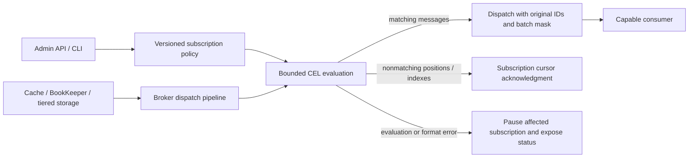

# PIP-419: Support subscription message filtering on brokers

Status: Draft revision for community discussion.

Implementation PR: Not submitted. The APIs, configuration, and protocol additions below are proposed changes.

# Background knowledge

A Pulsar topic stores messages once and exposes independent subscription cursors. A subscription can have multiple consumers, but its filtering policy must have one meaning for all of them. Rejecting a message for one subscription must not delete it for other subscriptions.

[PIP-105](https://github.com/apache/pulsar/blob/master/pip/pip-105.md) introduced the `EntryFilter` broker extension. Its existing `ACCEPT`, `REJECT`, and `RESCHEDULE` results apply to an entire storage entry. The dispatcher individually acknowledges rejected positions for the subscription. Pulsar JMS demonstrates that selectors can be built using these extension points; this proposal addresses the additional work needed for an integrated, administratively managed feature.

An entry can contain a batch of messages with different properties. Those properties are in each message's `SingleMessageMetadata`; the entire batch payload can be compressed or encrypted. Filtering the outer entry metadata alone cannot implement arbitrary per-message property selection. Existing batch-index acknowledgment masks let the broker and supporting clients preserve the identity of individual messages within an entry.

Messages may be read from the ManagedLedger cache, BookKeeper, or tiered storage. Filtering after these read paths converge provides the same subscription behavior for all three. It does not eliminate BookKeeper reads or the cost of maintaining non-contiguous acknowledgment ranges, commonly called ack holes.

# Motivation

Applications migrating from systems with subscription selectors need an easy way to consume only messages with selected properties, such as audio events from a particular source. Filtering after delivery wastes consumer processing and, when entire entries could have been rejected, network bandwidth.

Applications can already deploy entry-filter plugins. However, they still have to implement rule validation, administration, batch handling, update semantics, and monitoring. Providing these together makes subscription filtering usable without distributing executable plugins for each application's rules.

The feature is optional. It provides message selection within an authorized subscription; it is not a substitute for topic authorization or a boundary that hides message bytes from consumers.

# Goals

## In Scope

- Broker-side filtering of application-defined string properties using a restricted CEL profile.
- One durable, versioned policy per subscription, managed through the Admin API and CLI.
- Standard persistent topics and their physical partitions, with durable Exclusive, Failover, Shared, and Key_Shared subscriptions.
- Non-batched messages and unencrypted batches, including mixed batches and compressed batches.
- Stable message IDs, subscription-specific acknowledgments, bounded execution, and observable failures.
- Existing transaction visibility, delayed delivery, redelivery, and retention semantics.
- Explicit client capability negotiation and an operational upgrade/rollback procedure.

## Out of Scope

- BookKeeper predicate execution, storage indexes, and selective reads from object storage.
- Filtering message bodies, schema-dependent expressions, arbitrary scripts, or consumer-specific rules.
- Rewriting a batch to remove selected payloads or renumbering its batch indexes.
- Decrypting end-to-end encrypted batches on brokers.
- Chunked messages, non-persistent topics, non-durable/compacted readers, scalable topics, and replicated subscriptions in the initial implementation.
- Recovering messages already acknowledged by an earlier filter policy.
- An exact, continuously maintained count of matching messages in an unscanned backlog.

# High Level Design

An administrator installs a validated expression on an existing subscription. The broker persists a versioned policy, compiles it once, and evaluates it against message properties during dispatch. Producers continue to publish ordinary Pulsar messages. Consumers subscribe normally after advertising support for this feature; they do not supply an expression.



For a non-batched message, a nonmatch suppresses the whole entry. For a batch, the evaluator produces a decision for each eligible message. A completely rejected batch is not sent. A mixed batch is sent unchanged with a delivery mask that excludes rejected and already acknowledged indexes.

Consequently, a mixed batch can still carry rejected messages' bytes over the connection, although conforming clients do not expose those messages to the application. The initial design saves whole-entry transfers and consumer work; it makes no proportional bandwidth-saving claim for mixed batches. Applications needing stronger bandwidth reduction can use smaller or suitably grouped batches. Filtering does not change access-control guarantees.

# Detailed Design

## Design & Implementation Details

### Policy ownership and persistence

The policy belongs to the subscription, independent of which consumer is connected. Store its JSON descriptor in a cursor string property, proposed as `#pulsar.internal.subscription.message.filter`, under the existing `ManagedCursor.CURSOR_INTERNAL_PROPERTY_PREFIX`. The schema is:

```json
{
  "schemaVersion": 1,
  "revision": 7,
  "enabled": true,
  "language": "CEL",
  "expression": "'messageType' in properties && properties['messageType'] == 'audio'"
}
```

The initial revision is `0`, representing no policy. Each successful change increments the revision. Disabling stores a tombstone with `enabled: false` and a new revision; it does not reset revision numbering. Disabled descriptors omit `language` and `expression`. Deleting the subscription removes its policy with the cursor.

The dedicated API below is the only application-facing writer of the reserved property. Reuse the internal cursor-property update mechanism: `setCursorProperties` already preserves internal properties and rejects callers setting that prefix, while trusted broker code can use `putCursorProperty`. Enforce the same restriction on consumer-supplied properties and all subscription-creation paths. Internal cursor updates merge unrelated properties. These protections also apply when filtering is disabled in broker configuration. Redact the descriptor in existing cursor/property error logs as well as in new filter logs.

The owner broker serializes policy changes, ordinary property changes, and subscription deletion through a subscription mutation queue and persists them using the cursor's metadata version checks. A stale owner or a stale expected revision cannot overwrite a newer descriptor. A failed validation or a known failed write leaves the previous policy effective; an uncertain persistence outcome keeps dispatch gated until read-back establishes the durable revision. A valid request for an identical effective policy is a no-op after checking the expected revision.

On topic load, compile an enabled descriptor before permitting dispatch. An unknown schema/language, an invalid persisted expression, or an enabled policy on a broker with filtering disabled blocks that subscription and is exposed through the status API. None of these cases permits unfiltered delivery.

### Expression language

Use [CEL for Java](https://github.com/cel-expr/cel-java), an Apache-2.0-licensed expression engine. Pin the dependency and its transitive dependencies in the implementation after dependency and license review; a library version is not part of the persisted policy format.

The version-1 environment exposes only `properties`, typed as `map<string, string>`. The allowed CEL subset consists of Boolean/string literals, parentheses, `!`, `&&`, `||`, string equality/inequality, string-key membership in `properties`, and literal-key indexing of `properties`. The checked result must be Boolean. No other identifiers, function overloads, macros, comprehensions, regex operations, arithmetic, conversions, extension functions, or object access are enabled. The checked AST is validated against this allowlist, in addition to ordinary CEL type checking.

For example:

```text
'messageSource' in properties &&
properties['messageSource'] == 'wechat' &&
'messageType' in properties &&
properties['messageType'] == 'audio'
```

Missing keys follow CEL semantics. A guarded missing key gives a nonmatch; an unguarded missing-key error is an evaluation error. Property values remain strings, with case-sensitive comparison and no implicit numeric conversion. Decode duplicate property keys deterministically using the same last-value-wins mapping as the Java client's properties view. A batch uses each message's own properties, not the first message's or a union of the batch's properties.

`true` means match and `false` means permanent rejection for this subscription. An error is neither result: retain the position, stop new dispatch for the affected subscription, and expose a bounded error code and the failing position. An administrator can repair or disable the policy. No message is acknowledged just because evaluation failed.

Compilation happens when a policy is validated, installed, or recovered, never once per message. Compiled programs are immutable and shared through a bounded cache keyed by expression, language-profile version, and runtime options. Every evaluation has its own bindings; no mutable evaluation context is shared between dispatch and backlog analysis.

### Dispatch integration and existing entry filters

Keep the public `EntryFilter` interface and the existing custom-plugin ordering/results unchanged. Add a broker-internal subscription message evaluator to the common persistent dispatch path. This is necessary because the existing enum cannot represent a partially matching batch or an evaluation failure that must suspend dispatch.

The built-in evaluator runs only on application messages eligible for delivery, after transaction visibility, internal-marker, delayed-delivery, and existing entry-filter handling have determined eligibility. Internal markers must continue through their existing lifecycle and must not be evaluated as application property maps. A custom filter's `REJECT` or `RESCHEDULE` keeps its current behavior; the new evaluator does not turn it into an acceptance.

An enabled subscription policy is applied independently of broker/topic entry-filter plugin configuration. Changing `allowOverrideEntryFilters` or the plugin list cannot accidentally disable it. The built-in evaluator never returns `RESCHEDULE` to retry another consumer: all consumers on a subscription have the same rule.

Introduce an internal evaluation result containing accepted/rejected indexes or an error, rather than changing the plugin SPI. Integrate its result with `AbstractBaseDispatcher`, `PersistentSubscription`, `EntryBatchIndexesAcks`, and the existing consumer delivery accounting. Apply it to normal reads and replay reads from every storage source. Existing custom-plugin counters retain their current meaning; the new evaluator has separate metrics.

### Batches, message identity, and formats

For an unencrypted batch, decode its metadata and, if needed, decompress its payload once per evaluation task within the configured memory limit. Use the existing Pulsar batch parser to visit the `SingleMessageMetadata` of each eligible message; do not deserialize application payloads. Validate declared sizes/counts and enforce the output limit while decompressing, rather than allocating an unchecked `uncompressed_size`.

Let `U` be the indexes still unacknowledged and eligible under the existing pending-transaction-ACK state. Evaluate only those indexes. Let `R` be the rejected subset. Individually acknowledge `R` using the existing batch-index acknowledgment representation and deliver `U - R`. Existing ACK masks use set bits for remaining messages; combine masks accordingly, without changing the original `(ledgerId, entryId, batchIndex, batchSize)`. Stage a whole entry's decisions before applying them: if evaluating any eligible index fails, apply none of that entry's new rejections and preserve its existing ACK state.

For a mixed batch, send the original encoded entry with the combined mask. Never mutate a shared cache entry, recalculate a batch's indexes, or replace its stored payload. A batch with no deliverable indexes is not sent. Consumer permits, pending-ACK ownership, and message counters must reflect deliverable indexes, while byte counters reflect the actual encoded bytes sent. Redelivery, cumulative ACK where supported, negative ACK, and transactional ACK must preserve the same masks. Require broker batch-index acknowledgment support to enable the feature.

For example, a batch with indexes `0=audio`, `1=video`, and `2=audio`, filtered for audio, acknowledges index 1 for this subscription and delivers the original entry with remaining indexes `{0, 2}`. The returned messages retain batch indexes 0 and 2, and another unfiltered subscription still receives all three messages.

| Input | Behavior with an enabled policy |
| --- | --- |
| Non-batched message, including compressed or encrypted payload | Evaluate its visible message properties without decoding the body. |
| Unencrypted batch | Evaluate each eligible message's properties; preserve IDs and encoded entry. |
| End-to-end encrypted batch | Pause this subscription at the position; neither skip it nor deliver it unfiltered. |
| Chunked message | Pause this subscription; chunk reassembly/filtering is outside the initial implementation. |
| Malformed entry or decompression limit exceeded in the new evaluator | Report an error and preserve its position for operator action. |
| Unsupported subscription/topic mode | Reject policy activation or the incompatible subscribe request. |

Encryption of a non-batched payload does not conceal its outer properties. If all filterable properties are encrypted inside a batch, the broker cannot evaluate them. Producers can continue writing unsupported formats for other subscriptions, but operators must understand that such data will block a filtered subscription. This limitation must appear in user documentation and activation guidance.

### Execution limits and backpressure

Expression compilation, batch decompression, and evaluation run on a dedicated bounded broker executor, not Netty event loops. Hold only bounded entry references and decoded buffers. Reserve memory before decoding, release it on every success/error/cancellation path, and pause new reads when the queue or byte budget is full. Saturation causes backpressure, not rejection or unfiltered delivery.

Results return to the dispatcher in the ordering required by that subscription type. Each task carries the subscription generation and policy revision. Closing, unloading, or replacing a policy invalidates unfinished tasks; stale completions release resources and cannot deliver or acknowledge messages. The no-policy path avoids this executor and preserves the existing dispatch behavior.

The restricted expression AST and bounded input sizes limit evaluation work. A timeout alone is not sufficient protection because cancellation may not interrupt a decompressor or evaluator. Enforcement must bound work/allocation and retain resource accounting until the task actually exits.

Filtering still reads and scans data. Charge filtered work against the configured dispatch/scan budgets, including entries for which no messages are sent, so a zero-match rule cannot bypass throttling. Bound consecutive all-rejected reads and yield between them; consumer flow permits alone are insufficient to limit a scan that produces no deliveries.

### Acknowledgments, ack holes, and rule changes

Rejected messages are acknowledged only for the affected subscription. They remain readable by other subscriptions and remain subject to normal retention. This is permanent consumption for this cursor, not a temporary delivery preference.

Ack holes still occur when rejected entries are interleaved with accepted, unacknowledged entries. Filtering does not make those ranges disappear or guarantee immediate ledger deletion. Coalesce adjacent rejection ranges, bound pending rejection work, and integrate with ManagedCursor persistence/backpressure. A filtered dispatcher must stop additional forward scanning before exceeding its safe persistent state budget; it must continue servicing client ACKs and eligible redeliveries so outstanding gaps can close. Account for serialized bitmap bytes as well as range counts, and for the separate `managedLedgerMaxBatchDeletedIndexToPersist` limit. Reserving space must cover the decisions in already admitted tasks. Do not truncate ranges or batch-index state to maintain progress. The implementation must demonstrate this behavior under slow consumers and broker failure.

An update has the following per-physical-subscription sequence:

1. Validate/type-check the new expression and check the expected revision, capabilities, and limits.
2. Pause new evaluations and establish a dispatcher barrier. Complete or cancel old-revision work; callbacks must not cross the barrier unnoticed.
3. Persist outstanding filter rejection acknowledgments from the old revision, then persist the new descriptor and publish its compiled policy.
4. Resume dispatch and complete the operation. If persistence fails or its outcome is uncertain, retain the gate until the durable state has been reconciled.

The required ACK persistence barrier is an implementation requirement, not a claim that the existing asynchronous ACK callback already guarantees it. Verify the callback's durability contract and add a bounded cursor flush/barrier if needed. It must verify complete persistence of rejection ranges and partial-batch masks, not successful serialization of a truncated subset. If the state cannot be persisted completely, fail the policy update without advancing its revision. Persisting the new policy before old rejection decisions are durable could resurrect previously filtered messages under a different expression after a crash and is not allowed.

Messages already handed to a consumer before the barrier cannot be recalled. They remain acknowledgeable. A subsequent redelivery is evaluated under the policy then active; newly rejected messages can therefore be consumed by the filter. Previously durably rejected positions do not reappear after widening or disabling the rule. Replaying retained data requires an explicit cursor reset or a new subscription, and uses its current rule. These operations have normal at-least-once delivery behavior; this PIP does not promise exactly-once evaluation or delivery.

### Partitioned topics

The REST resource accepts either a physical topic or a logical partitioned topic. Physical subscriptions own their revisions. For a logical topic, GET returns the policy/revision/status for every partition, and PUT carries the complete expected-revision map from that read. Validate that the partition set still matches before starting changes and perform per-partition compare-and-set updates.

There is no atomic switch across partitions. A fan-out can partially succeed, including during owner changes. Return explicit per-partition applied/conflict/error results; never report complete success or silently roll back applied revisions. The caller reads the current state and retries with the complete current revision map; partitions already at the requested effective policy are no-ops. Concurrent incompatible updates are surfaced by revision conflicts.

Serialize partition expansion with filter administration using a fenced per-logical-topic coordination record in the metadata store. This is new coordination required by this proposal; process-local locking is insufficient. New partitions inherit a policy only after all existing partitions have the same enabled/language/expression tuple; their local revision starts with their own first installation. If policies disagree or cannot be read, reject expansion until reconciled. Existing partition expansion deliberately strips internal cursor properties, so inheritance must be an explicit trusted installation step, not an ordinary properties-map copy. Install inherited policies before allowing subscriptions on the new partitions to dispatch, including client-driven subscription creation. Complete activation requires every existing physical subscription to have succeeded.

## Public-facing Changes

### Public API

Add GET and PUT at:

```text
/admin/v2/persistent/{tenant}/{namespace}/{topic}/subscription/{subscription}/messageFilter
```

Reuse ownership redirects and the existing `authoritative` query parameter. GET requires permission to consume that subscription. PUT requires tenant administration permission, using the existing administrator authorization mechanism; ordinary subscription consume permission does not authorize changing selection rules. No endpoint implicitly creates a subscription.

GET and versioned disable operations remain available when broker-side execution is disabled or a recovered policy cannot be compiled, so operators can inspect and repair that state. Installing an enabled policy requires the feature and its prerequisites to be available.

PUT request for a non-partitioned topic:

```json
{
  "enabled": true,
  "language": "CEL",
  "expression": "'messageType' in properties && properties['messageType'] == 'audio'",
  "expectedRevisions": {"persistent://public/default/events": 0}
}
```

`expectedRevisions` is required and maps each affected physical topic's canonical name to the revision returned by GET. A disable request sets `enabled: false`, omits `language`/`expression`, and still supplies expected revisions. An enabled request must specify `CEL` and a nonempty expression. Unknown request fields and languages are rejected; unknown descriptor schema versions block activation/recovery.

GET and successful PUT return `{"partitions": {"<physical-topic>": <state>}}`. Each state contains `revision`, `enabled`, `language`/`expression` when enabled, `status`, and nullable `lastError`. Status is one of `DISABLED`, `ACTIVE`, `UPDATING`, or `BLOCKED`. `lastError` contains a stable `code`, sanitized `message`, and nullable `position` with `ledgerId`, `entryId`, and `batchIndex`. It never includes message property values or payloads. A subscription without a descriptor has revision `0` and status `DISABLED`.

| HTTP status | Meaning and body |
| --- | --- |
| 200 | GET state, or PUT fully persisted and applied on all affected partitions. |
| 307 | Existing owner redirect, with `Location`. |
| 400 | Invalid request, unsupported language, or invalid/rejected expression. Standard `ErrorData` JSON with a sanitized `reason`. No policy mutation. |
| 401 / 403 | Missing authentication / insufficient authorization; standard `ErrorData`. |
| 404 | Topic or subscription does not exist; standard `ErrorData`. |
| 409 | Stale revisions, topology change, incompatible consumers/mode, or conflicting operation. Before mutation: standard `ErrorData`. After fan-out starts: the partial-result body below. |
| 429 | Validation/compilation admission limit reached; standard `ErrorData`, with no new mutation admitted. |
| 503 | Feature unavailable or persistence/owner failure. Before mutation: standard `ErrorData`; after fan-out starts: the partial-result body. |

The partial-result body contains `reason` and a `partitions` map. Each value includes `outcome` (`APPLIED`, `CONFLICT`, `FAILED`, or `UNKNOWN`), nullable `revision`, and nullable sanitized `errorCode`. `UNKNOWN` means the caller must GET to determine whether persistence succeeded. All requested partitions appear in the response. Network timeouts likewise require read-back; a retry with stale revisions cannot overwrite an applied update.

Add synchronous/asynchronous `getSubscriptionMessageFilter` and `setSubscriptionMessageFilter` methods and corresponding request/state/result types to the Java Admin API. These are new proposed API names. Keep expression management out of `ConsumerBuilder`; producers and consumers cannot overwrite the policy during connection/reconnection.

### Binary protocol

Add an optional Boolean `supports_subscription_message_filtering`, default `false`, to the existing connection `FeatureFlags`, using the next available field number at implementation time. Add its corresponding `PulsarClientException.FailedFeatureCheck` entry as required by that protocol's conventions. The broker and client advertise it only when they implement the specified delivery-mask behavior; it does not assert that every topic has a filter.

Initially implement this capability in the Java clients, with the same contract available to other clients. Enabling a policy requires all already attached consumers to advertise support. Later incompatible subscribers are rejected with the existing `UnsupportedVersionError` path and a descriptive reason. Reject incompatible readers/modes as well. Compatible consumers must honor delivery masks even when their ordinary ACK aggregation settings differ. Proxies must preserve the actual client's capability rather than asserting support on its behalf.

Reuse `CommandMessage.ack_set` for batch delivery; no change to BookKeeper or stored message formats is proposed. The feature flag provides an explicit compatibility guarantee instead of assuming every historical client correctly handles a broker-filtered mixed batch.

### Configuration

All names and defaults in this table are proposed, broker-scoped startup settings. Zero/negative sizes and inconsistent limits are rejected at startup. The no-policy path does not allocate a filter worker pool when the feature is disabled.

| Name | Default | Meaning |
| --- | --- | --- |
| `subscriptionMessageFilteringEnabled` | `false` | Allow activation and execution of the built-in feature. Existing enabled policies block dispatch when false. |
| `subscriptionMessageFilterMaxExpressionBytes` | `4096` | Maximum UTF-8 expression size. |
| `subscriptionMessageFilterMaxAstNodes` | `256` | Maximum parsed/checked expression size; also bound parser nesting to 32. |
| `subscriptionMessageFilterMaxDecodedEntryBytes` | `16777216` | Maximum decoded bytes for one batch; enforce during decompression. |
| `subscriptionMessageFilterMaxInFlightBytes` | `67108864` | Broker budget for retained input and decoded buffers, reserved before work. |
| `subscriptionMessageFilterThreads` | `2` | Workers for bounded compilation/evaluation/decompression. |
| `subscriptionMessageFilterMaxPendingEntries` | `128` | Maximum queued entry tasks per broker; exhausted admission pauses reads. |
| `subscriptionMessageFilterMaxCachedExpressions` | `1024` | Maximum compiled programs in the shared cache. |

Use bounded compilation admission too; admin requests cannot create an unbounded queue. Live subscriptions may retain references to their active programs, so their memory must be accounted for separately from the evictable cache and bounded through existing subscription limits plus a measured per-policy bound. The implementation must publish that bound and include it in broker memory planning.

Activation also requires the existing `acknowledgmentAtBatchIndexLevelEnabled` capability. It must validate the cursor's usable persistence/range and partial-batch limits and must not claim to solve ack holes by merely increasing `managedLedgerMaxUnackedRangesToPersist`. A runtime change that removes a required capability must block affected dispatch, not discard its filter state. Limit/default tuning requires the benchmarks described below.

### CLI

Add these proposed `pulsar-admin topics` commands:

```shell
pulsar-admin topics get-subscription-message-filter persistent://public/default/events \
  --subscription audio

pulsar-admin topics set-subscription-message-filter persistent://public/default/events \
  --subscription audio --language CEL \
  --expression "'messageType' in properties && properties['messageType'] == 'audio'" \
  --expected-revisions-file revisions.json

pulsar-admin topics remove-subscription-message-filter persistent://public/default/events \
  --subscription audio --expected-revisions-file revisions.json
```

The revisions file contains the `expectedRevisions` map's contents. Set also accepts `--expression-file`, mutually exclusive with `--expression`. Remove performs a versioned disable operation. Commands print per-partition outcomes and exit nonzero on conflicts, failures, or unknown outcomes; they never retry by overwriting a newer revision. Disabling makes future unacknowledged messages eligible but does not recover previously filtered positions.

### Metrics

Keep the existing `pulsar_subscription_filter_*` plugin metrics and backlog definitions unchanged. Add the following built-in evaluator metrics, following the existing topic/subscription metric enablement and aggregation controls. Base Prometheus labels are `cluster`, `namespace`, `topic`, and `subscription`; use the existing partition-label splitting convention when enabled.

| Prometheus name | Type / unit | Additional labels | Meaning |
| --- | --- | --- | --- |
| `pulsar_subscription_message_filter_evaluations_total` | Counter / messages | `result=matched,rejected,error` | Per-message evaluation attempts, including re-evaluation after redelivery; not a count of unique messages or durable ACKs. |
| `pulsar_subscription_message_filter_blocked` | Gauge / 0 or 1 | None | 1 while an enabled policy cannot dispatch because of a persistent policy, format, or evaluation error. Queue backpressure alone does not set it. |
| `pulsar_subscription_message_filter_evaluation_seconds` | Histogram / seconds | None | Worker processing time per entry, including metadata extraction/decompression and CEL evaluation; excludes queue wait. |

Expose equivalent OpenTelemetry instruments named `pulsar.broker.subscription.message.filter.evaluations` (counter, `{message}`), `pulsar.broker.subscription.message.filter.blocked` (observable gauge, `1`), and `pulsar.broker.subscription.message.filter.evaluation.duration` (histogram, `s`). Reuse established cluster/topic/subscription attribute conventions; add a bounded result attribute `pulsar.subscription.message.filter.result` on the counter. Counters reset with subscription/broker lifecycle. Expressions, revisions, message IDs, and property values are never metric labels.

Existing backlog statistics continue to describe cursor backlog, including messages not yet evaluated. They must not be relabeled as matching backlog. Extend explicit backlog analysis to use the same evaluator with a captured policy revision, independent context, and existing entry/time limits. Report evaluated accepted/rejected message counts, errors, revision, and scan completeness; mixed-entry counts alone are insufficient. Analysis does not acknowledge messages, change live filter counters, or pause live dispatch on a scan error.

# Monitoring

Alert on a blocked filtered subscription and inspect the status API's bounded error code/position. Compare actual outbound bytes/messages with evaluation rates, worker latency, broker memory, cursor persistence latency, and unacknowledged ranges. High rejection rates with little reduction in outbound bytes can be normal for mixed batches. Low output with a growing physical backlog can indicate slow consumers, unsupported data, or expensive scans and must not be presented as an exact matching backlog.

Emit rate-limited error logs with topic, subscription, revision, position, and error category, excluding expressions and message data. Configuration validation rejects bad rules before activation where possible. Runtime errors require an explicit policy repair/disable or an existing administrative cursor operation, with the consequences of skipping data made clear.

# Security Considerations

Only authorized administrators manage policy expressions. Compile only the restricted CEL profile; do not expose Java objects, reflection, class loading, filesystem/network calls, clocks, random functions, or user-defined code. Bound expression parsing, queueing, decoded sizes, and retained memory before executing work. CEL's non-Turing-complete language alone is not a resource-isolation guarantee.

A filter expression can mention application property names/values, so policy reads use subscription authorization and logs/metrics do not copy its contents. Normal Pulsar authorization still decides access. In particular, a client receiving a mixed batch has its full encoded payload and could inspect rejected data outside the normal client API. Deployments requiring data separation must use authorization boundaries such as separate topics.

# Verification and performance plan

The following are implementation acceptance tests, not results already obtained for this document:

| Area | Required evidence |
| --- | --- |
| CEL | Allowed grammar and Boolean typing; forbidden overloads/macros; size/depth limits; guarded/unguarded missing keys; duplicate properties; deterministic results and isolated concurrent contexts. |
| Administration | Authorization and reserved-property bypass attempts; revision conflicts; persistence failure/unknown outcome; concurrent property updates and deletion; recover-before-dispatch; enable/disable with active consumers. |
| Delivery | All supported subscription types; no-policy regression; all-match/no-match/mixed batches; compression; stable IDs; existing and filtered ACK-mask intersection; permits and byte/message accounting. |
| Failure and concurrency | Broker crash before/after ACK and policy persistence; unload with tasks in flight; cancellation/buffer leaks; queue/byte-budget saturation; no stale-policy delivery or ACK after the barrier. |
| Messaging features | Redelivery, negative/cumulative ACK, transactional ACK commit/abort, producer transaction visibility, delay/expiry, reset/seek, Key_Shared ordering with its normal batching constraints, and independent subscriptions. |
| Formats and clients | Encrypted non-batched properties; encrypted batches/chunks blocked without loss; malformed/oversized compressed inputs; unsupported clients/modes rejected; proxies and both Java client APIs. |
| Storage and topology | Cache hits, BookKeeper reads, offloaded reads, partition fan-out partial results, topology races, and inherited policies before new-partition dispatch. |
| Accounting | ACK-hole growth under a deliberately slow consumer; restart preserves rejected batch indexes; bounded scan/replay work; physical backlog and explicit scan counts; plugin/built-in metrics kept distinct. |

Benchmark the no-policy path, existing `EntryFilter` baseline, and the new evaluator with cache hits and backlog reads; 0%, 1%, 50%, and 100% matches; small/large messages; unbatched/homogeneous/mixed batches; and one/many subscriptions. Record throughput, p50/p99 latency, CPU, allocation/retained memory, actual network bytes, ACK-range growth, and persistence cost. Include a zero-match backlog, a slow consumer, and broker restart. Publish the results before declaring the feature implementation complete. This draft contains no performance measurements or claimed speedup.

# Backward & Forward Compatibility

## Upgrade

1. Upgrade every broker eligible to own the affected namespace and all relevant proxy/client paths. Keep the feature disabled while doing so.
2. Verify supporting consumers, batch-index acknowledgments, resource limits, and the topic's data formats. Existing backlog may contain formats the first implementation cannot filter.
3. Enable filtering on all eligible brokers, then use the Admin API to activate policies. Pre-create a subscription without consumers if its first delivery must already be filtered.
4. For partitioned topics, check every partition's result; a partially applied operation is not complete activation.

An older broker ignores the reserved policy property and could dispatch unfiltered data. Therefore active filtered subscriptions must not be moved to old brokers. No unknown-field behavior or default-off setting can make that mixed-version deployment safe. Existing unfiltered subscriptions and stored entries remain compatible with old clients/brokers.

## Downgrade / Rollback

Before routing filtered namespaces to old brokers, disable every filter using the new API and verify that all owners completed their dispatcher/ACK persistence barriers. Alternatively stop consumption and isolate those namespaces from old owners. Retain operator records of expressions if they will be restored later.

Disabling does not restore discarded positions. Recovery requires retained data and an explicit reset/new subscription. An old broker cannot enforce either the policy or the reserved-property protections, so removing a binary or turning off a flag is not a substitute for this procedure.

## Pulsar Geo-Replication Upgrade & Downgrade/Rollback Considerations

Ordinary topic replication continues to replicate the stored messages, unaffected by a local subscription's selection. Policies are local subscription state and are not automatically replicated. Configure independent subscriptions deliberately in each cluster. Replicated subscriptions are excluded initially because shared cursor progress and differing filter revisions need a separate cross-cluster consistency design; reject enabling that combination in either direction.

# Alternatives

- **Existing custom `EntryFilter` or Pulsar JMS selectors:** valid choices today. The proposed feature integrates lifecycle, administration, and batch behavior for ordinary Pulsar subscriptions; it does not remove these extensions.
- **Whole-entry filtering only:** much smaller, but cannot offer general per-message property semantics for default mixed batches. It would require explicit producer batching restrictions.
- **SQL-92 selectors:** offer familiarity and reuse, but this proposal chooses a small CEL profile and a typed environment. SQL-92 compatibility and additional CEL functions can be considered separately.
- **Groovy or a general expression runtime:** substantially broader execution and resource behavior than property comparisons require. The restricted CEL profile avoids exposing that surface.
- **Consumer-supplied expressions:** create conflicts within shared subscriptions and couple changes to client deployment. Management through a single subscription policy provides a clear owner.
- **Rewriting mixed batches:** could save more bandwidth, but changes payload/checksum/encryption handling and risks message identity and ACK compatibility. It is deferred.
- **BookKeeper filtering/indexes:** could reduce storage-to-broker transfers for cold reads, but require separate storage/protocol work and do not cover cache/tiered reads or remove cursor semantics. They are deferred.

# General Notes

Deliver the implementation in reviewable steps: policy/validation and capability negotiation; non-batched dispatch and durability barriers; batch-mask integration; then failure, compatibility, and performance validation. Keep the feature disabled until the complete supported behavior above passes its acceptance tests. A non-batched prototype alone does not complete this PIP.

The initial client requirement, CEL subset, mixed-batch bandwidth tradeoff, unsupported encrypted batches/chunks, and partition update semantics are explicit decisions proposed for community discussion. This revision does not represent an accepted vote or an implemented feature.

# Links

- Proposal PR: https://github.com/apache/pulsar/pull/24305
- Prior architectural review: https://github.com/apache/pulsar/pull/24305#issuecomment-2882812437
- Administrative rule ownership: https://github.com/apache/pulsar/pull/24305#discussion_r2090332563
- Expression and ack-hole concerns: https://github.com/apache/pulsar/pull/24305#issuecomment-2884530595
- CEL recommendation: https://github.com/apache/pulsar/pull/24305#issuecomment-3154098019
- Pulsar message and batch format: https://pulsar.apache.org/docs/next/developing-binary-protocol/
- Mailing List discussion thread: Not started for this revision.
- Mailing List voting thread: Not started.
