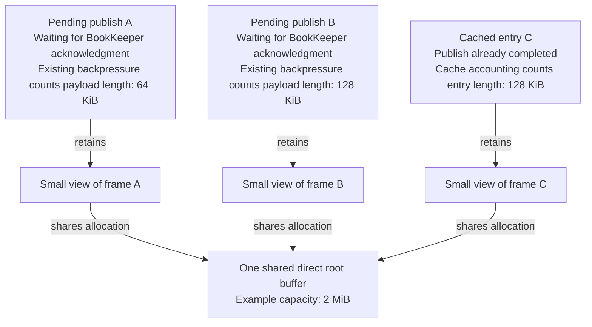
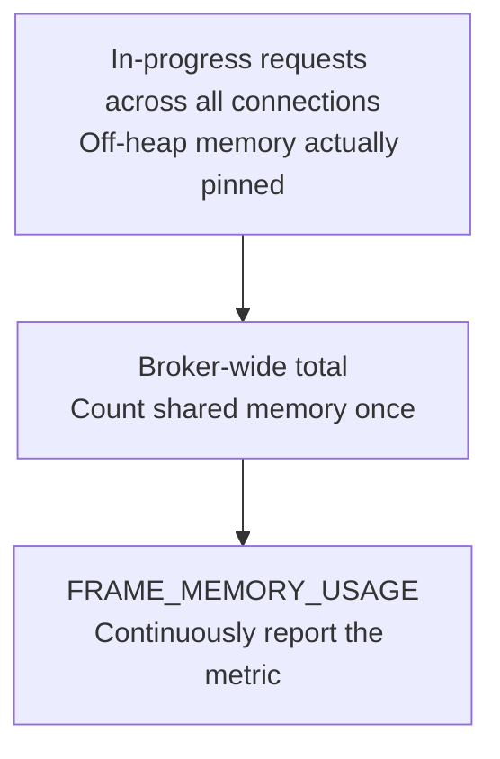

# PIP-499: Track retained request-frame memory and throttle broker requests

# Background knowledge

Across multiple production clusters, we have repeatedly observed broker OOM failures when BookKeeper
responses slow down. We consistently reproduced broker direct-memory exhaustion on both Pulsar 4.0.14 and
5.0.1 with a simulated workload.
The complete test conditions and reproduction procedure are provided in
[Reproducing the original failure](#reproducing-the-original-failure) below.

## Problem analysis and diagnosis

Pulsar receives client commands through Netty. A TCP read can contain several protocol frames or only part of
one frame. `LengthFieldBasedFrameDecoder` accumulates incoming bytes and extracts complete frames as retained
views of a buffer. A maximum message size bounds an individual frame; it does not bound the capacity of the
buffer that contains several frames.

This proposal calls the underlying `ByteBuf` referenced by frame views the **root buffer**. **Root ByteBuf capacity**
is that buffer's current `capacity()`: the number of bytes it can currently hold, including unwritten or already-consumed
space that still belongs to the buffer. It differs from an individual message's payload length or a slice's
length. Allocation size classes and pooling can reserve additional memory; space not exposed by `capacity()`
is outside this definition. Root ByteBuf capacity therefore does not represent the entire memory pool or the process's
total off-heap memory usage.

A retained slice or duplicate shares its underlying allocation. After the decoder releases its reference,
asynchronous work can still retain that allocation: a publish waiting for BookKeeper, an outbound write, or a
managed-ledger cache entry. The allocation becomes reusable only after its remaining owners release it.
Returning a pooled allocation to Netty does not necessarily return that memory to the operating system.

The existing `maxMessagePublishBufferSizeInMB` mechanism accounts for the logical bytes of pending publishes.
Its accounting is shared by connections on an I/O thread, with a threshold derived from the broker setting.
`maxPendingPublishRequestsPerConnection` independently limits pending publish requests. Neither count expresses
the capacity of the underlying buffers retained by those requests.

The managed-ledger entry cache holds entries for subsequent reads and dispatch. With
`managedLedgerCacheCopyEntries=false`, a cached entry can retain its original inbound buffer. The cache's size
accounting uses entry lengths, so a small cached entry can keep a much larger allocation alive.

The diagram illustrates ownership after the decoder has released its own reference, with
`managedLedgerCacheCopyEntries=false`. All lengths and capacities are illustrative; arrows show retained
references and shared memory, not the order of message processing.

For example, after publish A completes, publish B may still be waiting for BookKeeper acknowledgment.
Its 128 KiB payload is enough to keep the entire 2 MiB buffer pinned. The payload, cache, and root ByteBuf capacity
measurements describe overlapping memory and must not be added together.

# Motivation and Goals

1. **Make actual memory retention visible:** Provide a continuously available metric so users can understand
   the direct memory retained by in-progress requests even in `DISABLED` mode. As an additional
   benefit, comparing it with logical pending-publish bytes helps identify extra retention from small frames
   pinning large buffers.
2. **Protect the broker automatically under memory pressure:** When this additional retention pushes broker
   direct-memory usage to a dangerous level, activate backpressure to allow memory to drain and reduce OOM risk.
3. **Offer a more conservative, proactive policy:** Let users select `ENABLED`, always
   controlling subsequent request admission using the actual memory pinned by pending requests, without
   waiting for memory pressure.

# Terminology

The following names are used throughout the remaining sections without repeating their definitions.

| Name | Meaning |
| --- | --- |
| `FRAME_MEMORY_USAGE` | Total direct-buffer capacity retained by request frames across all connections in the current broker, in bytes, counting shared memory once. Reported by `pulsar.broker.publish.in.progress.buffer.memory.usage`. |
| `MEMORY_LIMIT_THRESHOLD` | The `maxMessagePublishBufferSizeInMB` setting converted to a byte threshold. |

Direct-memory utilization is the current broker's direct-memory usage divided by its maximum
direct-memory budget, expressed as a percentage.

`maxMessagePublishBufferSizeInMB` supports dynamic updates. Once the broker receives an update, existing and new
connections all use the latest `MEMORY_LIMIT_THRESHOLD`, including the derived activation, throttling, and recovery thresholds.

# High Level Design

## Accounting for request-frame memory

Every connection always uses a tracking frame decoder, continuously accounting for and reporting
`FRAME_MEMORY_USAGE` regardless of whether limiting is enabled.

## Throttling rules

`inProgressRequestFrameMemoryLimitEnabled` becomes a startup-only three-state setting, defaulting to `AUTO`.
It cannot be changed dynamically; changing it requires a broker restart. Configure the same value on each
broker when a uniform cluster policy is desired.

| Value | Behavior |
| --- | --- |
| `ENABLED` | Always apply frame-memory thresholds, without checking automatic activation or deactivation conditions. |
| `AUTO` | Activate or deactivate fallback protection based on memory pressure, locally to each broker. |
| `DISABLED` | Force frame-memory limiting off, without automatic fallback activation. |

All three modes continuously account for and report `FRAME_MEMORY_USAGE`.

In `ENABLED` mode, pause subsequent socket reads when `MEMORY_LIMIT_THRESHOLD > 0` and
`FRAME_MEMORY_USAGE > MEMORY_LIMIT_THRESHOLD`, then clear this throttle and resume reads when usage falls to
`MEMORY_LIMIT_THRESHOLD / 2` or below (subject to other throttling rules).

In `AUTO` mode, activate or deactivate the above throttling policy under the following conditions:

- **Activate automatically:** On new input, if `MEMORY_LIMIT_THRESHOLD > 0`, direct-memory utilization is at least 85%, and
  `FRAME_MEMORY_USAGE > 1.5 × MEMORY_LIMIT_THRESHOLD`, enable protection and log the transition. Frame-memory limiting
  begins on subsequent inbound reads.

  **Note:** When `FRAME_MEMORY_USAGE > MEMORY_LIMIT_THRESHOLD`, the existing pending-publish limit is insufficient
  to keep actually retained memory within that threshold. Its memory-protection goal is no longer met, although
  the existing rule still operates on logical payload bytes.

- **Deactivate automatically:** Disable automatic protection when input or memory release observes
  direct-memory utilization below 65%, or when a configuration update sets `MEMORY_LIMIT_THRESHOLD ≤ 0`.

Releases can trigger recovery without a periodic task; cache copying remains independent.

# Detailed Design

## Metric granularity and precision

`FRAME_MEMORY_USAGE` is a broker-level byte counter covering all connections,
without per-topic, per-producer, or per-connection breakdowns. It counts bytes exactly within the root ByteBuf capacity
scope defined above; each sample is a snapshot of that counter, not an estimate derived from message lengths.
It is not an exact measurement of all broker off-heap memory: allocator reserves, allocation-size overhead
not exposed in root ByteBuf capacity, and other untracked memory are excluded.

Add a broker-level gauge, `pulsar.broker.publish.in.progress.buffer.memory.throttled`, reporting the current
actual frame-memory throttling state:

- `1`: Frame-memory throttling is being enforced.
- `0`: Frame-memory throttling is not being enforced, even if the feature is enabled.

## Behavior when forced on

Starting with `inProgressRequestFrameMemoryLimitEnabled=ENABLED` makes the broker continuously compare its
own `FRAME_MEMORY_USAGE` with `MEMORY_LIMIT_THRESHOLD` to apply inbound backpressure. Memory usage is counted
per broker, without splitting it by connection or aggregating it across brokers.

All connections use the latest `MEMORY_LIMIT_THRESHOLD`; dynamic updates do not require reconnection.
When `MEMORY_LIMIT_THRESHOLD > 0` and `FRAME_MEMORY_USAGE > MEMORY_LIMIT_THRESHOLD`, pause subsequent socket reads
on all connections while keeping the connections open. When `MEMORY_LIMIT_THRESHOLD ≤ 0`, do not apply this
frame-memory limit and clear any existing frame-memory throttles.

When `FRAME_MEMORY_USAGE ≤ MEMORY_LIMIT_THRESHOLD / 2`, clear the frame-memory throttle on all connections and resume
socket reads (sockets still throttled for other reasons remain subject to those rules). Memory releases trigger
recovery checks without waiting for new requests. Delivery of messages already read follows the rules below.

**Note:** `MEMORY_LIMIT_THRESHOLD / 2` retains the recovery-threshold ratio used by existing pending-publish
throttling: 50% of the throttling threshold.

## Automatic fallback activation and deactivation

This mechanism operates only in `AUTO` mode.

- **Activate:** On new input, if `MEMORY_LIMIT_THRESHOLD > 0`, direct-memory utilization is at least 85%, and
  `FRAME_MEMORY_USAGE > 1.5 × MEMORY_LIMIT_THRESHOLD`, enable protection and log the transition. This transition only
  enables the policy; enforcement using `FRAME_MEMORY_USAGE` and the latest `MEMORY_LIMIT_THRESHOLD` starts on
  subsequent inbound reads.
- **Deactivate:** If input or memory release observes direct-memory utilization below 65%, or a configuration
  update sets `MEMORY_LIMIT_THRESHOLD ≤ 0`, disable protection and clear its frame-memory throttles. Other read throttles
  remain effective.
- **Measurement unavailable:** Skip state decisions that require direct-memory measurements; frame-memory
  accounting continues.

Automatic state applies only to this broker, without persistence or cross-broker propagation. These events
provide the required checks and recovery without a periodic task.

## Behavior when forced off

Starting with `DISABLED` preserves frame-memory accounting and metrics, but never applies frame-memory
throttling, samples direct-memory utilization, or automatically activates protection. Existing pending-publish
limits and other backpressure mechanisms remain effective. Selecting another mode requires a broker restart.

## Separate socket reads from processing already-received messages

Disabling `autoRead` stops subsequent automatic socket reads but cannot withdraw data already in the decoder.
For example, one input contains `[A, B, C, D]`. While processing this already-received input, the decoder
triggers frame-memory throttling and sets the connection to `autoRead=false`, but can still decode and emit
complete messages from that input.

These messages enter **the decoded-message queue inside `PulsarFlowControlHandler`**, downstream of the decoder
and upstream of `ServerCnx`. The existing handler also uses `autoRead` to control automatic queue delivery:
when it is `false` and no explicit read is requested, messages remain queued instead of reaching `ServerCnx`
for business processing. Queued publish requests therefore cannot be submitted to BookKeeper and release
their retained buffers through write completion.

The queued messages still retain root ByteBufs through slices or other views, with their capacity already
counted in `FRAME_MEMORY_USAGE`. Until those references are released, usage may remain above the recovery
threshold, while the queue waits for throttling to clear and `autoRead` to resume delivery. This creates a
circular dependency: releasing memory requires processing messages, but memory throttling prevents that
processing. Frame-memory throttling triggered by the decoder alone can cause this problem; prior Topic
throttling is not required.

This PIP retains `PulsarFlowControlHandler` and the existing handler order, controlling new data reception
separately from processing messages already received:

| Active throttles | Automatic socket reads | Delivery of decoded, queued messages |
| --- | --- | --- |
| None | Allow | Allow |
| Request-frame memory only | Pause | Allow |
| Topic, pending-publish, or other throttles only | Pause | Pause |
| Both categories | Pause | Pause |

When only frame-memory throttling remains, actively resume the existing queue without waiting for new input
or re-enabling `autoRead`, so messages already counted in `FRAME_MEMORY_USAGE` can complete and release memory.
Recheck other throttling reasons after each delivered message; pause delivery immediately if Topic,
pending-publish, or another throttle activates again. Processing the existing queue must neither temporarily
enable `autoRead` nor request more socket data when the queue becomes empty.

# Monitoring

Compare `FRAME_MEMORY_USAGE` with pending-publish payload usage and direct-memory usage. A growing difference
between retained root ByteBuf capacity and logical entry bytes is evidence of retention amplification to investigate,
not by itself proof of a leak. Correlate it with BookKeeper write latency, publish completion latency,
connection throttling, and cache configuration.

# Alternatives

- **Only lower the existing payload limit.** A smaller logical budget may help a workload, but the relationship
  between payload lengths and retained roots varies with read batching, fragmentation, and owner lifetime.
- **Copy every frame at extraction.** This separates frame lifetimes from cumulation, at the cost of a copy
  and allocation on the general inbound path. The proposed accounting preserves sharing; cache copying
  remains an independently selectable policy where retention is longer-lived.
- **Return the charge when the decoder replaces cumulation or when one publish completes.** Either event can
  occur before the last downstream slice releases the old root, recreating the undercount.
- **Limit only total direct-memory usage.** That measurement includes pool reservations and unrelated users;
  it does not identify request roots whose release can recover input capacity. This proposal uses it to
  activate protection, then uses retained-root usage to throttle and resume.
- **Force cache copying or clear caches when limiting activates.** This couples independent policies and can
  discard useful cache contents during storage pressure. Dynamic copying affects future insertions only.
- **Pause queued delivery along with the frame-memory throttle.** The queue can retain the roots needed
  for recovery. This proposal retains the handler and delivers already-read messages when Topic,
  pending-publish, and other throttles have all cleared.

# General Notes

## Reproducing the original failure

The reproduction configuration below uses Pulsar broker `5.0.1`, BookKeeper `4.18.2`, and Pulsar Java client `5.0.1`,
with cluster image `apachepulsar/pulsar:5.0.1`. The workload is based on performance framework revision
`8e618164815b9f99939bc1af969a5f285e4762b1`, with both producers and consumers using client `5.0.1`.

> [!IMPORTANT]
> **Key to reproduction: use a resource-constrained Bookie with a small write cache to slow publish writes and acknowledgments.**
> This example sets `dbStorage_writeCacheMaxSizeMb=16`, using limited resources and a small write cache to create a BookKeeper storage bottleneck.
> No BookKeeper client patch or artificial delay is used.

### Reproduction versions and execution environment

| Item | Condition |
| --- | --- |
| Cluster | Pulsar broker `5.0.1`, BookKeeper (Bookie) `4.18.2`; cluster image `apachepulsar/pulsar:5.0.1`. |
| Workload implementation | Existing `TelemetryProducer` (`iot-produce`) and `TelemetryConsumer` (`iot-consume`) from the framework revision above; no changes to their send/receive logic for this reproduction. |
| Client | Both producers and consumers use Pulsar Java client `5.0.1`, through `org.apache.pulsar.client.api.PulsarClient`. |
| Host | macOS 13.5.1, AArch64, 10 reported hardware threads, 32 GiB RAM. |
| Connection path | Direct plaintext `pulsar://...:6650` connections to the broker. The scenario did not enable TLS, a Pulsar proxy, or network impairment. |
| Experiment purpose | Reproduce direct-memory exhaustion while storage is slower than offered publish load. This was an exploratory Docker Desktop run, not a Linux production capacity benchmark. |

### Topology and resource budgets

| Component | Count and placement | JVM and cache settings |
| --- | --- | --- |
| Broker | One broker | `-Xms2g -Xmx2g -XX:MaxDirectMemorySize=2g`; managed-ledger entry cache 8 MiB. |
| Storage | One Bookie | `-Xms512m -Xmx512m -XX:MaxDirectMemorySize=512m`; DbLedgerStorage write cache 16 MiB and read-ahead cache 16 MiB. |
| Producer workload | One client node container/JVM hosting 32 `PulsarClient` instances | `-Xms6g -Xmx6g -XX:MaxDirectMemorySize=12g` for that JVM as a whole. These limits are not multiplied by 32. |
| Consumer workload | One application, one pod, one container/JVM, one `PulsarClient` | `-Xmx512m -XX:MaxDirectMemorySize=256m`; no explicit `-Xms` override. |

The client node memory was enlarged to avoid the producer JVM exhausting direct memory before the broker.
The Bookie continued to perform real writes; no fixed response delay, forced request failure, or modified
BookKeeper client was involved. Its reduced storage caches and resources created storage pressure. There
were no per-container CPU quota overrides in the resolved scenario; the Docker engine was allocated six CPUs and 28 GiB of memory in total.

### Broker and BookKeeper policies

| Setting | Value and source |
| --- | --- |
| Ensemble / write quorum / ack quorum | `1 / 1 / 1`, explicitly configured. This is a reproduction topology, not a production durability recommendation. |
| Broker deduplication | `brokerDeduplicationEnabled=true`, explicitly configured. |
| Storage request timeouts | `bookkeeper_addEntryTimeoutSec=30` and `bookkeeper_readEntryTimeoutSec=30`, explicitly configured. |
| Entry cache | `managedLedgerCacheSizeMB=8`, explicitly configured; `managedLedgerCacheCopyEntries=false` from the 5.0.1 default, with no scenario override. |
| Existing payload-byte backpressure | `maxMessagePublishBufferSizeInMB` was not overridden. The 5.0.1 default is half the direct-memory limit with a 64 MiB minimum, yielding 1,024 MiB for this broker. The existing limiter remained enabled. |
| Pending publish requests | `maxPendingPublishRequestsPerConnection` was not overridden; the 5.0.1 default is 1,000. This counts broker publish requests, not the workload's logical message count. |
| Broker I/O threads | Not overridden; the 5.0.1 default is `min(2 × availableProcessors, max(8, availableProcessors / 2))`, using integer division. This is separate from the workload's explicitly configured client thread pools. |
| Managed-ledger rollover | Maximum 100,000,000 entries, minimum rollover time 60 minutes, maximum rollover time 1,440 minutes, maximum size 16,384 MiB. |
| Cursor-ledger rollover | Maximum 100,000,000 entries and rollover time 86,400 seconds. |
| Bookie maintenance | Journal maximum size 8,192 MiB; `gcWaitTime=86400000` and `gcOverreplicatedLedgerWaitTime=86400000` milliseconds; minor and major compaction intervals both `-1`. |

The new frame-memory tracking and automatic protection in this proposal did not exist in the tested broker.
The experiment therefore exercises the existing payload/request limits with cache copying disabled.

### Producer workload and message construction

| Item | Condition |
| --- | --- |
| Topics | 16 persistent topics, named `persistent://public/default/iot-telemetry-0` through `iot-telemetry-15`. |
| Devices | 100,000 device identities. Each device maps to topic index `deviceId % 16`. |
| Producer instances | One producer for each client node/topic pair: `32 * 16 = 512` producer objects. All are precreated, with at most 32 producer creations in flight. Producer objects are not equivalent to TCP connections. |
| Client resources | All 32 clients share one resource set with 16 I/O threads and 16 listener threads; these are not 16 threads per client. |
| Sending | One workload loop chooses a device and a client node using the fixed random seed `0x51c0ffee`, then calls `sendAsync()`. Producer names and sequence IDs are explicitly assigned. |
| Outstanding bound | One shared semaphore for the whole producer workload, sized to `min(maxOutstanding, deviceCount) = 100000`. The 32 clients and 512 producers share this bound; it is not 100,000 per client node or per producer. |
| Per-device concurrency | At most one uncompleted send per device. Send completion, including failure, removes the device from the in-flight set and returns a semaphore permit. |
| Queue-full and timeout behavior | The workload explicitly sets `blockIfQueueFull(true)` and `sendTimeout(0, SECONDS)`. Individual producer send timeout is disabled; the experiment still has a 900-second workload timeout. |
| Batching | Explicitly enabled with `BatcherBuilder.KEY_BASED`. The client defaults are at most 1,000 messages, 128 KiB, and 1 ms publish delay; the workload does not override those three defaults. |
| Compression | No override; the recorded client version defaults to `CompressionType.NONE`. |
| Message key | An eight-byte encoding of the device ID. |
| Payload | Exactly 49,152 bytes (48 KiB) before Pulsar protocol/batch metadata. The first 32 bytes encode device ID, device sequence, send timestamp, and measurement flag; the remaining newly allocated bytes are zero-filled. |
| Offered load | `rate=0`: no configured messages-per-second pacing. Sending is constrained by the shared outstanding bound, client behavior, and broker/storage progress. |
| Warmup | Zero warmup messages and zero warmup seconds; no inter-round delay. |
| Measurement target | 1,000,000 logical messages, about 45.78 GiB of payload if all are sent. The positive message-count setting takes precedence over the inherited `measurement.seconds=120`; this is not a fixed 120-second run. |
| Timeout and restarts | Workload timeout 900 seconds; scheduled pod restarts disabled (`intervalSeconds=0`, `fraction=0.0`). Broker exits/restarts after OOM are outcomes, not injected faults. |

# Links

* Implementation: [PR #27110](https://github.com/apache/pulsar/pull/27110).
* Dynamic entry-cache copying (outside this PIP): [PR #27148](https://github.com/apache/pulsar/pull/27148).
* Mailing List discussion thread: Not started.
* Mailing List voting thread: Not started.
