# PIP-499: Use allocator memory accounting for plaintext broker backpressure

# Background knowledge

A producer's message can be a small view of a much larger network allocation. One socket read can contain
several messages or only part of a message. The framing stage may combine successive reads into a larger
buffer. Completing a publish therefore does not necessarily free the underlying allocation: another
message, a BookKeeper write, a cache entry, or a consumer send can still reference it.

The existing publish-memory backpressure accounts for logical pending-publish bytes. The entry cache
accounts for entry lengths. Neither measurement expresses the allocation space kept alive by those
references. Lowering a payload limit can help a particular workload, but the relationship between payload
bytes and retained allocations changes with message size, receive batching, and reference lifetimes.

The original investigation observed direct-memory exhaustion under slow BookKeeper responses. A reported
failure was `OutOfDirectMemoryError` with a failed 4 MiB allocation and both used and maximum memory at
2 GiB. This identifies an allocation-budget failure; it should be distinguished from a native allocation
failure or an OS/container OOM kill. The original reproduction conditions are retained under
[General Notes](#reproducing-the-original-failure). They reproduce the original problem, not the behavior
of the revised design proposed here.

Netty distinguishes memory pinned by live buffers from memory retained by a pool. Releasing a buffer
makes its allocation reusable, but does not require an idle chunk to be returned to the underlying
allocator or operating system. Size classes, pool caches, and fragmentation also affect pool occupancy.
The native allocator and operating-system memory policy further affect RSS. This proposal does not
measure or bound process RSS.

| Symbol | Definition |
| --- | --- |
| `U` | Direct memory pinned by live buffers allocated from this broker's shared plaintext-channel allocator, including allocation-size rounding and active huge allocations. |
| `R` | Direct memory currently reserved by the same allocator, including live allocations, reusable space, allocator caches, fragmentation, and active huge allocations. This is a current retained amount, not a historical allocation count. |
| `L` | The current positive `maxMessagePublishBufferSizeInMB` value converted to bytes. A nonpositive value disables this additional throttle. |
| `M` | Netty's effective global direct-memory limit in bytes, including any applicable `io.netty.maxDirectMemory` override. This is the same limit used as the denominator of `G`. |
| `G` | Current broker-wide Netty direct-memory utilization: Netty's current global direct-memory usage divided by its effective direct-memory limit, including any applicable `io.netty.maxDirectMemory` override. `G >= 90%` means usage is at least 0.9 times that limit. |

`U` is neither the sum of message payload lengths nor the pending-publish byte count. Cached data and
consumer sends can retain an allocation after the original publish completes. Shared views of an
allocation are counted once by the allocator. `R - U` is not automatically a leak. `G` covers the
Netty global direct-memory counter's scope, including allocations outside the request pool that use
that counter. It does not include memory outside Netty's accounting, heap usage, or process RSS, and
is not the request pool's `R` alone.

# Motivation

Operators need a way to see and control the direct memory that plaintext request handling keeps alive
when storage or consumers are slow. Logical publish limits can remain below their configured budget while
small retained messages pin substantially larger allocations. Pausing messages that have already arrived
can then prevent the processing needed to release those allocations.

This proposal uses an isolated allocation pool to make ownership measurable without an additional layer
of per-buffer reference accounting. It combines backpressure on future automatic reads with processing
of already-decoded complete messages. After ten unsuccessful recovery checks, it synchronously clears
marked cache entries to release long-lived cache references.

A marked entry is a cache entry inserted from a publish by sharing its buffer while normal cache
copying is disabled. The mark identifies a cleanup candidate, not precise allocator ownership; marked
entries can include data outside the request pool. The objective is to reduce memory-exhaustion risk
while preserving useful sharing during normal operation. This is soft backpressure and does not
guarantee that the broker cannot run out of memory.

# Goals

## In Scope

- Measure active and reserved direct memory of plaintext channels through one broker-owned allocator.
- Provide observation-only operation and explicit, broker-wide activation of the additional throttle.
- Permit enforcement only when `0 < L <= 0.6M`; within that range, pause subsequent automatic reads when `G >= 90%` and `U >= 1.3L`, and recover when `U < L` or `G < 70%`. Larger positive limits allow observation only.
- Keep already-decoded messages progressing when this is the only active throttle.
- Preserve normal cache sharing and synchronously clear marked entries after ten unsuccessful recovery checks.
- Apply dynamic numeric-limit changes to existing and new eligible connections, and expose the result through metrics.

## Out of Scope

- **TLS connections are outside this mechanism's scope.** Their channel allocator is not switched to the dedicated pool, and this policy does not pause their reads. Existing allocation and backpressure mechanisms remain effective.
- Running this mechanism for multiple broker instances in one JVM.
- Operation with pinned tracking disabled, including estimating active usage from chunk, subpage, or thread-cache statistics.
- A hard admission reservation, a bound on all broker direct memory, or a process/container RSS limit.
- Per-topic, per-producer, or per-connection memory budgets and metrics.
- Discarding incomplete requests or closing connections solely to reclaim their framing buffers under memory pressure.
- Tuning the general receive-buffer size policy, native allocator, or operating-system memory settings.
- Estimating request memory by subtracting BookKeeper or a fixed fraction of entry-cache usage from total memory.

# High Level Design

In `TRACKING` or `ENABLED`, the broker measures plaintext-channel allocations through one shared pool;
only `ENABLED` with `0 < L <= 0.6M` can apply this memory throttle. While throttled, it pauses future automatic reads,
lets eligible complete messages progress, and synchronously clears marked cache entries after ten
unsuccessful recovery checks. Clearing runs on the sampling control thread and may delay later checks.
It deliberately retains incomplete client requests under the existing framing and connection
policies. Fresh memory samples and the latest enforcement eligibility determine when this throttle
clears; reserved memory `R` is diagnostic only.

Operators select `inProgressRequestFrameMemoryLimitEnabled` at broker startup. Changing this mode requires
a restart; the default is `DISABLED`. `TRACKING` and `ENABLED` require pinned tracking, which is
enabled by default in the checked Netty versions. This revision does not support running those modes
with pinned tracking disabled. `ENABLED` additionally requires usable Netty global direct-memory
accounting at startup; otherwise startup fails with the conflicting configuration and corrective actions.

| Mode | Behavior |
| --- | --- |
| `DISABLED` | Keep the ordinary allocation path; add no dedicated pool, sampling tasks, delayed cache clearing, or new metrics. |
| `TRACKING` | Use the dedicated plaintext pool and report memory metrics; do not apply this memory throttle or delayed cache clearing. |
| `ENABLED` | Add memory throttling and pressure actions only when `0 < L <= 0.6M`; otherwise keep observation only. |

Enforcement requires `0 < L <= 0.6M`, including equality at `0.6M`. If a broker is configured as
`ENABLED` with `L > 0.6M`, it serves in observation-only behavior: no throttle, recovery task, or
pressure cache clearing from this mechanism. This eligibility guard alone does not reject startup
or rewrite the configured mode or numeric limit; startup accounting validation still applies.
Log a warning with `L`, `M`, and the observation-only behavior at startup and when entering that
behavior after a limit update. Explicit `TRACKING` always
remains observation only. `DISABLED` keeps its existing meaning. All enforcement and pressure actions
described below are subject to this eligibility rule.

A broker started in `TRACKING` or `ENABLED` mode creates one shared allocator for its plaintext channels.
The allocator is installed before those channels can read. Socket reception, framing-buffer merging and
expansion, and upstream protocol-header processing all use this pool. This preserves the existing sharing
of inbound data and requires no extra copy merely to account for reception. TLS channels retain their
ordinary allocator and do not receive this read throttle. A request-pool allocation remains in `U` while
any owner retains it, including a sender on a TLS channel; TLS exclusion does not remove those references
from accounting.

The allocator follows allocation lifetimes itself. A retained view, a storage write, or a cache reference
continues to pin the allocation until its final owner releases it. The framing layer does not wrap
buffers or maintain a parallel root-reference counter. Netty's existing receive and framing control flow
remains in use; this policy introduces no custom decoder continuation mechanism. It deliberately
retains incomplete requests instead of discarding their buffers or closing connections to reclaim
that memory. Those allocations remain fully included in `U`.

New buffers for consumer message coalescing uniformly use `PulsarByteBufAllocator.DEFAULT`,
separating their allocation ownership from client-request reception. The existing JVM property
`pulsar.allocator.default.type` selects the backend that owns these new allocations.

A normal broker-wide task samples `U` and `R` every five seconds in `TRACKING` mode or once per second
in `ENABLED` mode. In `ENABLED`, activation and recovery checks also obtain current global utilization
`G`. When `0 < L <= 0.6M`, activate memory throttling on all eligible connections only when both
`G >= 90%` and `U >= 1.3L`. High `U` alone does not activate this policy.

Activation immediately starts one additional broker-wide recovery task, scheduled every 300 ms while
throttled. Clear only this throttle and stop the recovery task when either `U < L` or `G < 70%`; the
normal task continues. `G = 70%` with `U >= L` remains throttled. Queue delivery on all eligible
connections obeys other business backpressure. The tenth unsuccessful recovery check synchronously clears
marked cache entries before returning. Sampling and clearing share one control thread, so clearing can
delay subsequent checks beyond the nominal 300 ms interval. Other throttle reasons remain effective.
`R` is reported for diagnosis and is not a separate throttle input.

```mermaid
stateDiagram-v2
    state "Not memory-throttled" as normal
    state "Memory-throttled" as throttled
    [*] --> normal
    normal --> throttled: ENABLED, 0 < L <= 0.6M, G >= 90%, U >= 1.3L
    throttled --> normal: U < L or G < 70% or L <= 0 or L > 0.6M
    note left of normal
        TRACKING: sample U and R every 5 s.
        ENABLED: check activation every 1 s.
        L > 0.6M: observation only.
        DISABLED: no dedicated pool or sampling.
        R is observation only in either active mode.
    end note
    note right of throttled
        Pause automatic reads.
        Immediately start recovery checks every 300 ms.
        Continue delivery of eligible complete messages.
        Synchronously clear marked entries after ten unsuccessful recovery checks.
        Clearing may delay subsequent checks.
        With valid samples, stay throttled while U >= L and G >= 70%.
        Either U < L or G < 70% permits recovery.
        L <= 0 or L > 0.6M clears this throttle immediately.
        On exit: clear only this throttle; stop recovery checks.
        Keep the normal sampling task running.
    end note
```

For example, with `M = 2000 MiB` and `L = 1000 MiB`, enforcement is eligible. `G = 92%` and
`U = 1300 MiB` activate throttling, including equality at the active-usage threshold. At `G = 80%`,
even `U = 1600 MiB` does not activate it. Once throttled, either `U` falling strictly below 1000 MiB
or `G` falling strictly below 70% permits recovery. At `U = 1000 MiB` and `G = 70%`, keep throttling. Queued complete messages can still reach normal
processing if no other throttle blocks delivery. If ten recovery checks still cannot clear this
throttle, synchronously clear marked cached entries. Evicting 512 MiB of entries is not itself evidence that
512 MiB of request-pool memory was released. New cache insertions retain their configured normal behavior.

The existing payload-byte, pending-request, topic-rate, and other backpressure mechanisms remain active.
The new policy adds another throttle reason; it does not replace their counters or resume decisions.

# Detailed Design

## Design & Implementation Details

### Allocation coverage and statistical boundary

The supported deployment is one broker per JVM. Eligible channels share one dedicated request allocator,
which may be registered under a fixed name as a JVM-wide singleton; it is not created per connection.
The default `DISABLED` mode does not create or register this pool. The pool and its thread caches follow
existing allocator and thread lifecycles; this proposal adds no multi-broker isolation, allocator
unregistration, or dedicated thread-cache cleanup mechanism.

The allocator must cover both socket receive allocations and replacements made while merging or expanding
framing input. Covering only the framing replacement path misses input used directly; covering only
reception misses replacements allocated elsewhere. PROXY protocol buffering and other supported upstream
allocation paths must preserve this coverage as well.

The sampling design uses a fixed pooled-direct backend. Its configuration inheritance, deliberate
exceptions, and startup validation are specified under Allocator configuration and startup validation below.
Unpooled or adaptive allocators are not interchangeable with this backend for the accounting defined here.

Allocator accounting continues while storage, cache, or downstream senders retain views of a request
allocation. Replacing the channel allocator does not move previously allocated buffers. Allocations that
explicitly select another allocator remain in that allocator. The pool is therefore selected at channel
initialization, not switched only after pressure is detected.

ACK, FLOW, PING, and other non-publish input shares this receive pool. Small heap-to-direct send conversions
and one-time PROXY detection overhead are accepted statistical noise and do not require separate isolation.
Consumer message coalescing must explicitly allocate all new output buffers from
`PulsarByteBufAllocator.DEFAULT`, regardless of the BookKeeper client or storage class supplying the
entries. A custom BookKeeper allocator does not redirect these output allocations. This is the shared
default allocator used by the standard BookKeeper client factory and other general Pulsar operations,
not a dedicated consumer or storage pool. Keeping new output allocations in this allocator separates
them from client-request ingress (`client -> broker`) and prevents them from directly increasing the
request pool's `U` and triggering publish backpressure.

The existing JVM property `pulsar.allocator.default.type` determines the backend and memory-pool
ownership of these new output allocations. For example, switching from `adaptive` to `pooled` with
`-Dpulsar.allocator.default.type=pooled` places new coalesced output in `DEFAULT`'s Netty pooled backend.
The change affects all users of `PulsarByteBufAllocator.DEFAULT`, not only consumer delivery. It is
read when that allocator is initialized and requires a broker restart to take effect. Changing the
property does not migrate existing buffers or select the dedicated request pool; that pool remains a
separate instance even when both backends are pooled. No output-allocator setting is added by this PIP.

Coalesced output uses `PulsarByteBufAllocator.DEFAULT` whether the entries came
from BookKeeper reads, cache hits, or newly published data. Redirecting new output allocations does not
move or release the original entry buffers. Request-pool allocations still held by senders, caches, or
storage operations remain in `U` until their final reference is released, including when delivery retains
the original data without copying.

### Allocator configuration and startup validation

The initial implementation fixes the request pool's backend and validates its accounting before serving
eligible connections. It reuses existing allocation settings with explicit exceptions for the backend,
thread-cache sizes, and heap fallback. These allocator settings apply only to the new request pool;
existing allocators keep their configuration and allocation policies.

1. **Fixed pooled-direct backend.** The request pool does not inherit backend selection from
   `pulsar.allocator.type` or allocator-specific type overrides. Those selectors continue to apply to
   other allocators. No new backend-selection setting is introduced for the request pool.
2. **Inherited sizing, with smaller thread caches.** Reuse Netty's effective arena counts, page/chunk
   sizing, alignment, cache-eligible thread policy, and cache-trimming settings. Derive the new pool's
   small and normal cache entry counts from half of the corresponding existing configuration, keeping
   zero disabled and applying Netty's queue-capacity rounding. With the checked defaults, the counts
   change from 256 to 128 and from 64 to 32, respectively. Do not add request-pool-specific tuning
   settings or change other allocators' caches. Caches belong to an allocator and an allocating thread;
   these counts are per size class, not byte budgets. Halving only the new pool's counts limits extra
   retention but does not preserve the old aggregate cache budget or halve `R`. Released regions in
   thread caches are outside `U`. Treat one half as the initial default and measure throughput, tail
   latency, CPU, and `R` before drawing performance conclusions.
3. **Explicit OOM and leak-detection behavior.** Ordinary request allocations preserve the existing OOM
   notifications and configured exit-on-OOM behavior, including applicable allocator-specific settings,
   and use the global leak-detection policy. The request pool does not inherit heap fallback: failed
   direct allocations follow the normal error path instead of moving pressure into heap memory outside
   `U` and `R`. This is an explicit exception to a shared heap-fallback setting. Pressure cleanup evicts
   cache entries without allocating payload copies, so no recovery-copy allocation entry point is needed.
4. **Validate actual accounting capability.** Require a pooled-direct backend with at least one direct
   arena, actual pooled direct allocations, and available nonnegative `U` and `R` statistics. An allocator
   type name or current system-property value alone is insufficient. Reject an effective zero-direct-arena
   configuration instead of silently changing it or accepting unpooled direct allocations with unknown
   statistics. On versions with an off switch, explicit `io.netty.trackPinnedMemory=false` is invalid for
   `TRACKING` and `ENABLED`. Do not mutate this global property to enable tracking: Netty may already have
   initialized its static tracking policy.
5. **Small-allocation startup probe and diagnostics.** Before eligible channels start reading, while
   the new pool has no concurrent users, record `U`, hold a small allocation that uses the pooled direct
   path, verify that `U` increases, and verify that final release restores the baseline. Always release
   the probe on failure as well. The increase need not equal the requested length because of size-class
   rounding. A huge-allocation probe is insufficient: huge allocations can remain counted even when
   pooled pinned tracking is disabled. Releasing the probe need not restore `R`; a cold probe can reserve
   a whole chunk. Accept and account for that startup cost. Unavailable statistics or a failed probe
   reject startup in `TRACKING` and `ENABLED` with a clear error. `DISABLED` creates neither this pool nor
   the probe. Startup diagnostics report the effective backend, direct-arena count, chunk size, derived
   cache sizes, intentional inheritance exceptions, and validation result.

`ENABLED` also validates global direct-memory accounting before accepting connections: Netty's current
global usage must be available and nonnegative, and its effective limit must be positive. Failure is a
startup configuration conflict, even when `L <= 0` or `L > 0.6M` currently prevents enforcement; a later
dynamic limit update must not expose an unsupported configured mode. Do not silently downgrade the mode.
A successful request-pool probe does not replace this global capability check.

The startup error must identify `inProgressRequestFrameMemoryLimitEnabled=ENABLED`, the unavailable or
invalid global usage or limit, and relevant conflicting Netty settings and their values, such as
`io.netty.maxDirectMemory=0`. It must explain how to remove or correct the conflicting settings and
restart, or select `TRACKING` or `DISABLED` instead. After settings are corrected, validate the actual
counters again; a changed property value alone is insufficient. `TRACKING` and `DISABLED` do not require
global accounting; `TRACKING` still requires the request-pool accounting checks above.

### Sampling active and reserved memory

Each allocator sample reads the dedicated pool's current counters once: pinned direct memory `U`
for throttle decisions and reserved direct memory `R` for diagnosis. This revision requires pinned
tracking and does not implement an estimation path when tracking is disabled. In `ENABLED`, both
activation and recovery checks read Netty's current global direct-memory usage and its effective
direct-memory limit as a matching pair to derive `G`; they do not reuse an old metric sample. The
limit includes an applicable `io.netty.maxDirectMemory` override. Do not divide Netty usage by the
JVM direct-memory limit or fall back to JVM or direct-buffer-pool metrics. After successful startup
validation, a runtime sampling failure, an unavailable or negative Netty usage counter, or a nonpositive
limit makes `G` unavailable and follows the input-failure rules below. `R` is not compared with `L`.
Idle reservation may contribute to Netty's global usage, but activation still requires `0 < L <= 0.6M`, `U >= 1.3L`, and `G >= 90%`.

Sample `U` and `G` independently. Log and retry unavailable or invalid inputs; never treat them as zero
or replace them with stale values. Activation needs both inputs to meet their thresholds in the
current check, so failure of either prevents a new activation. Recovery needs only one observed
condition: a fresh `U < L` clears the throttle even if `G` is unavailable, and a fresh `G < 70%` clears
it even if allocator sampling fails. If no recovery condition is established, keep the active throttle.

Pinned tracking follows buffer allocation and final release, including allocation-size rounding and
huge allocations. It is enabled by default in the checked Netty versions, so no explicit system-property
setting is required. Where the version permits disabling it, `io.netty.trackPinnedMemory=false` is
incompatible with `TRACKING` and `ENABLED`. Startup validation must reject either mode with a clear
configuration error when pinned tracking is disabled or unavailable. `DISABLED` does not require it.
Failed accounting must be observable and must not silently become zero usage.

`R` includes currently retained pooled chunks and active huge allocations, using the same direct-memory
scope as `U`. Idle chunks remain in `R`; historical chunk allocations do not. There is no `R > 1.1L`
condition or other comparison of this pool's `R` with `L` for activation, and no recovery test based on `R`.

### Delivery of complete messages

Socket reception and delivery of already-decoded messages are separate decisions; both require a valid
connection and broker readiness. This memory
throttle pauses automatic reads while allowing complete queued messages to progress; other business
throttles can still pause delivery. The broker supplies delivery permission to flow control through
a callback, keeping the common component independent of broker-specific throttle types:

| Active throttles | Automatic socket reads | Delivery of queued complete messages |
| --- | --- | --- |
| None | Allow | Allow |
| This memory throttle only | Pause | Allow |
| Other business throttles only | Pause | Pause |
| This memory throttle and other business throttles | Pause | Pause |

Actively drain eligible queued messages on the connection's event loop. Defer draining until the current
pipeline callback returns and coalesce requests into at most one pending drain task per connection to
avoid reentrant delivery; no additional timer is needed. Merely permitting delivery is insufficient when
there is no further input to trigger it. In particular, clearing another business
throttle while the memory throttle remains must trigger queue delivery even though automatic reads remain
disabled. Recheck the delivery policy after every message. Queue draining must neither enable automatic
reads temporarily nor request another socket read when the queue becomes empty.

Each drain task delivers continuously in one invocation until the queue is empty or the current delivery
policy requires it to stop, including when another business throttle becomes active. It does not wait
for each publish to complete. If business backpressure pauses delivery, the normal policy-change
notification resumes the remaining queue when permitted. Do not add per-drain message-count or time-slice
budgets, or split draining into batches with extra scheduling to yield the event loop.

Omitting batch scheduling is a deliberate trade-off. The existing pending-publish payload limiter,
controlled by `maxMessagePublishBufferSizeInMB`, remains responsible for that in-flight publish budget;
pending-request, rate, and other business limits remain effective as well. This allocator-based policy
adds socket-read backpressure without replacing those controls or adding a second queue-delivery budget.
When no business limit pauses delivery, draining a large queue can occupy the event loop and delay
other connections or queued notifications. This cost is accepted to keep delivery simple; the existing
publish limits are not a strict bound on drain execution time.

### Deliberately retain incomplete requests

This memory-pressure mechanism deliberately preserves incomplete request data. It does not discard
framing buffers or close connections solely because those buffers retain direct memory, regardless
of their size.

An incomplete frame commonly holds a contiguous portion of an incoming request, and further fragments
are still pending client work. Remaining capacity in its allocation may be useful for completing the
frame. These buffers therefore represent live request state, not simply reclaimable holes. This does
not imply that every allocated byte contains useful payload: size-class rounding and shared-allocation
amplification still apply, and the allocator includes the full pinned capacity in `U`. Reclaiming the
buffer by dropping the request would lose that pending work and require client retries.

Netty's existing receive, decoder-continuation, maximum-frame-length, and connection-timeout policies
remain in use. This mechanism adds no per-connection pinned-capacity checks, memory-accounting wrappers,
custom continuation reads, or pressure-specific partial-frame timeout. Normal request completion or
connection closure releases the corresponding references; other owners may keep the allocation pinned.

A large population of connections holding incomplete requests can keep `U` and `G` at or above the recovery
watermarks even after complete messages and marked cache entries have been released. Paused reads can
then prevent those incomplete requests from finishing. Accepting this possibility is intentional;
automatic recovery is not guaranteed. If excessive connection count causes this condition, the
connection population does not fit the Pulsar deployment's memory capacity. Operators should expand
Pulsar capacity, including adding brokers and redistributing connections or increasing broker memory,
reduce connection count, or tune Netty receive-buffer allocation through
`ChannelOption.RECVBUF_ALLOCATOR` where the deployment supports it. This option controls receive-buffer
allocation sizing, not a hard bound on frame cumulation. This PIP adds no new receive-size setting or
automatic tuning policy. Recovery continues to depend on actual `U` and `G`.

### Share cache data normally; clear entries after ten recovery checks

This mechanism preserves normal cache sharing and synchronously clears marked entries within the tenth
unsuccessful recovery check. It does not add payload copies or migrate entries to another pool.
Normal insertion behavior remains in effect while the broker is under this
memory throttle.

`managedLedgerCacheCopyEntries` retains its existing independent meaning: `false`
shares entry data and `true` copies on normal cache insertion. Pressure does not rewrite this setting,
force extra copies, or introduce a special allocation path or copy budget.

On publish cache insertion, mark the new cached entry only when `managedLedgerCacheCopyEntries=false`
and its data is shared. When the setting is `true`, normal copying proceeds and the new entry remains
unmarked. Use one copy-setting snapshot for the insertion's copy and marking decisions. Storage-read
insertion does not set the mark. Normal cache copying keeps its ordinary allocation and failure policy;
it does not enter a special recovery-copy path.

Store the boolean on the actual cached entry and initialize it before publishing that entry to the cache.
Creation and recycling reset the field to `false`. A nonpositive `L` or observation-only behavior due to
`L > 0.6M` stops enforcement but does not stop marking eligible insertions, so returning to the
enforcement range needs no retrospective marking.
Do not maintain a separate long-lived index of entry references; select marked entries by safely walking
the current cache.

Do not inspect allocator identities, derived views, or composite components to maintain the mark. Accept
false positives and the resulting extra cache eviction; decisions still use measured `U` and `G`.

Start the recovery-round counter at zero on each transition into memory throttling. Each scheduled
300 ms recovery round first attempts fresh samples and evaluates both recovery conditions against the
latest limit. A failed input cannot satisfy a condition, but does not prevent the other input from
establishing recovery. If the throttle remains active, advance the counter. On the tenth such round,
reset the counter and synchronously clear marked entries across the broker's entry caches within that
recovery callback. If still throttled after another ten rounds, clear again so that later insertions can
also be removed. Normal one-second samples and numeric-limit updates do not advance this counter.
Ten rounds are approximately three seconds, subject to first-run timing, scheduling, sampling, and prior
clearing delays, rather than a strict deadline. Clearing is not submitted as a separate background task;
the callback continues only after its clearing pass finishes. If this round establishes recovery or the
controller has already processed a change that removes enforcement eligibility, do not start clearing.

Counting recovery rounds with failed samples is deliberate when no valid input establishes recovery:
once memory-throttled, unavailable statistics must not indefinitely postpone releasing cache references
that may prevent recovery. A failed sample is not evidence that the recovery conditions are unmet.
This choice accepts potentially unnecessary eviction, cache misses, and storage reads if actual usage
has already fallen.
Clearing alone does not authorize resuming reads. This throttle clears when a fresh sample satisfies
a recovery condition, or enforcement becomes ineligible because `L <= 0` or a known `L > 0.6M`.
Losing eligibility clears it without waiting for a usage sample. An initially unthrottled broker does not start recovery
rounds or pressure clearing merely because sampling fails.

Clearing removes only marked cached entries through safe cache eviction and releases only the cache's
references. It preserves unmarked entries and the validity of entries already held by readers or
storage operations. Subsequent cache misses use normal storage reads. Keep cache size and eviction
accounting correct and avoid double release when ordinary eviction races with clearing. Reuse existing
cache locks, identity checks, and reference-release rules. An evicted entry leaves the cleanup scope;
its field is reset when the object is recycled. The field adds no extra retained reference to an entry
or buffer. No cached payload is replaced and no metadata needs rebuilding for a migration copy.

Give each cache traversal a fixed endpoint. When a clearing pass starts traversing a cache, record
that cache's highest currently cached ledger/entry position once; skip an empty cache. Traverse only
positions up to and including that endpoint, removing marked entries and preserving unmarked ones.
Do not advance the endpoint to follow new insertions or repeat the walk until no marked entries remain.
Entries appended beyond the endpoint wait for a later pass. This bounds the traversal range,
not a consistent time snapshot: concurrent insertions within the range may or may not be visited;
unvisited marked entries remain eligible for a later pass. Store only the endpoint value, without
copying cache contents or retaining entry references to construct a snapshot. Each later pass records
a new endpoint.

Run clearing directly on the same broker control thread that processes sampling, numeric-limit updates,
and controller shutdown. A clearing pass finishes before that thread processes the next control action,
so passes cannot overlap and no separately queued clearing task or clearing-generation check is needed.
Configuration updates and controller shutdown wait for an in-progress pass to finish. Ordinary cache
insertion, reads, and eviction may still run concurrently and retain their existing synchronization.
Reset the round counter when the throttle clears. `TRACKING` and `DISABLED` never trigger this pressure
cleanup. New insertions continue to follow the configured normal copy policy.

Not adding batch budgets is a deliberate trade-off. The fixed endpoint only defines one traversal's
range; it does not limit the number of entries removed or the time spent, and is not a continuation
cursor between batches. This revision reuses the existing eviction path, keeps pressure recovery simple,
and prioritizes releasing cache references without introducing entry-count or time-slice budgets,
continuation cursors, or additional batch scheduling and settings.
Clearing a large cache can consume substantial CPU, contend on cache locks, affect business latency,
and delay normal sampling, 300 ms recovery checks, configuration processing, and controller shutdown.
These costs are accepted in exchange for serial execution without a separate cleanup scheduler or
cross-task cancellation protocol. There is no strict CPU, lock-hold-time, or cleanup-latency bound.

Removing entries is not itself recovery. Other entries, readers, or storage operations may retain the
same allocation, and the mark can include data outside the request pool. Keep sampling and clear this
throttle when a fresh `U < L` or `G < 70%` establishes recovery. A higher `L` can permit recovery
without `U` decreasing. A nonpositive `L` or a known `L > 0.6M` clears this throttle without waiting
for usage sampling.
Clearing cache references does not guarantee an immediate decrease in `R` or process RSS, and may increase
storage reads and cache misses.

### Scheduling, configuration changes, and shutdown

Sampling, synchronous cache clearing, numeric-limit updates, and controller shutdown execute serially on
one broker control thread. Clearing can delay later control actions; the configured sampling intervals
are nominal intervals, not deadlines. Connection callbacks apply the latest state on their event loops.
References to immediately clearing this throttle mean doing so when the control thread processes the
update, without waiting for a successful usage sample; they do not preempt an in-progress clearing pass.

One broker-wide normal task samples every five seconds in `TRACKING` or once per second in `ENABLED`;
`DISABLED` starts no sampling tasks. In `ENABLED`, the one-second task checks whether to activate
throttling. On activation, immediately start at most one additional broker-wide recovery task, sampling
and checking every 300 ms. Stop it after recovery or loss of enforcement eligibility, including
`L <= 0` or a known `L > 0.6M`. The normal task continues sampling metrics across throttle transitions and numeric-limit
updates. Queue delivery stays on connection event loops and does not block the control thread;
synchronous cache clearing does delay its later checks. Coalesce overdue normal, recovery, and
configuration-triggered sampling requests to avoid a backlog or bursts of catch-up recovery rounds.
Apply connection notifications only when
the decision changes, while newly active connections inherit the current state. Evaluate decisions
against the latest mode, limit, and lifecycle state, and ignore obsolete results after task cancellation
or shutdown.

Re-evaluate the `L/M` eligibility when the control thread processes numeric-limit updates. A known
`L > 0.6M` clears only this memory-throttle reason, stops its recovery task, resets its recovery-round
counter, and prevents further pressure clearing, even if usage sampling fails. Keep the pool, metrics,
and normal insertion marking. The normal task retains the configured mode's interval: an
`ENABLED` broker observing only due to this guard still samples once per second; explicit `TRACKING`
samples every five seconds. No extra timer or configuration value is introduced. If a later update
restores `0 < L <= 0.6M`, a configured `ENABLED` broker can enforce again after fresh samples satisfy
the activation conditions. The startup mode and legacy payload-limit behavior are not rewritten.

Apply connection state changes on their event loops, including to newly active eligible connections while
the broker is throttled. A connection's initial read setup must not override an existing throttle.
Readiness changes and throttle notifications use one decision path: automatic reads require a valid
connection, broker readiness, and no active business or memory throttle. The ready callback records
readiness and recomputes this decision instead of enabling reads directly. Queued notifications evaluate
current state when executed rather than applying a captured read setting; obsolete work cannot overwrite
newer decisions, and connection closure makes pending callbacks ineffective.
Numeric-limit updates request a fresh sample and re-evaluate usage against the latest limit without
requiring new inbound traffic. Within the enforcement range, only successful current samples may establish
activation or either recovery condition; earlier samples are not reused for decisions. A higher limit
can permit recovery without usage decreasing once a fresh sample succeeds. A nonpositive limit clears this reason immediately,
even when sampling fails or no successful sample exists.

When either input fails, log the failure and continue scheduled checks. Do not activate without both
required inputs, and preserve an active throttle unless the other fresh input establishes recovery
or a known numeric-limit change disables enforcement.
The initial state is unthrottled. Keep the last successful allocator values and their original
timestamp for metrics and diagnosis. They do not authorize a new throttle decision; no maximum reusable
sample age or expiry policy is needed. Before the first successful sample, do not observe `U` or `R`
and do not report unknown usage as zero. This runtime policy does not weaken startup capability validation.

Process controller shutdown on the control thread after any in-progress clearing pass finishes. Mark
the controller closed, cancel normal and recovery tasks, and prevent queued checks or connection
notifications from reviving it. Close this component's metric registrations or observation callbacks. The shared pool and its thread caches follow the existing
allocator and thread lifecycles described above. Buffers still retained by other owners remain valid until
normal final release.

One-second activation checks are soft backpressure, not a hard memory cap. Operators need free direct-memory
headroom for net growth during the sampling interval, scheduling, sampling, and cache-clearing delays,
and the time until connections actually pause reads, as well as already-read processing and normal receive/cumulation allocations.
Lowering `L` can restore enforcement eligibility or make the `U` activation condition easier to meet.
Once those conditions are satisfied, however, activation still waits for `G >= 90%`; lowering `L`
does not advance that global-pressure threshold. Size free capacity to cover net growth until the
next check and read suspension take effect, and increase usable memory if that headroom is insufficient.
Headroom means unused capacity in the overall direct-memory budget; idle chunks retained by one
allocator are not free global capacity. Allocations from other pools, including ordinary TLS allocations, remain outside
this pool's budget.

## Public-facing Changes

### Configuration

This proposal adds a startup mode and continues to use the existing dynamic memory-limit and
cache-copy settings. It also makes consumer coalescing use the existing default-allocator type setting.
Changing the mode requires a restart; the `L/M` eligibility guard determines whether a configured
`ENABLED` broker enforces the policy or only observes memory.

| Setting | Type, default, scope, and behavior |
| --- | --- |
| `inProgressRequestFrameMemoryLimitEnabled` | Broker startup enum: `DISABLED` (default), `TRACKING`, or `ENABLED`. Changing it requires restart. `DISABLED` keeps the ordinary allocation path and adds no pool, tasks, delayed cache clearing, or metrics from this PIP. `TRACKING` uses the plaintext pool and samples metrics without this throttle or delayed cache clearing. `ENABLED` permits enforcement only for `0 < L <= 0.6M`; larger positive limits allow observation only without rewriting the configured mode. Within that range, it activates throttling when `G >= 90%` and `U >= 1.3L`, recovers when `U < L` or `G < 70%`, and adds pressure actions. TLS channels keep their ordinary allocator and are not paused by this policy in any mode. |
| `maxMessagePublishBufferSizeInMB` | Existing broker integer setting in MiB. Keep its default of half the JVM direct-memory limit with a 64 MiB minimum. The additional mechanism uses one broker-wide `L`; dynamic updates affect existing and new eligible connections without reconnection. A nonpositive value disables and clears this additional throttle. `L > 0.6M` restricts this mechanism to observation; returning to the eligible range allows enforcement again only for configured `ENABLED`. The legacy payload limiter retains its existing behavior, including its connection-creation configuration snapshot. |
| `managedLedgerCacheCopyEntries` | Existing dynamic broker boolean, default `false`; updates apply to subsequent cache insertions. `true` keeps normal copying and `false` keeps normal sharing, including while memory-throttled. This mechanism does not rewrite the setting or force pressure copies. New publish cache entries are marked only when the insertion uses `false`; copied entries stay unmarked. Updates do not retroactively change existing marks. In eligible `ENABLED`, ten unsuccessful recovery checks synchronously clear existing marked entries even if normal copying has since been enabled. No exact allocator-ownership tracking is required. |
| `pulsar.allocator.default.type` | Existing JVM system property, supplied as `-Dpulsar.allocator.default.type=<value>`; supported values are `pooled`, `adaptive`, and `unpooled`. The checked worktree startup scripts explicitly select `adaptive`. Omitted settings follow the resolution order below; the built-in default is `pooled` only when no applicable type or legacy setting is present. It selects the backend of `PulsarByteBufAllocator.DEFAULT`, including new consumer-coalescing output and all other users of that allocator. Changing it changes those allocations' backend and pool ownership after a broker restart. It does not change the dedicated request pool's fixed pooled-direct backend or include these output allocations in that pool. |

For `PulsarByteBufAllocator.DEFAULT`, backend selection uses the first configured entry in this order:

1. `pulsar.allocator.default.type`.
2. `pulsar.allocator.type`.
3. The deprecated `pulsar.allocator.default.pooled` setting.
4. The deprecated `pulsar.allocator.pooled` setting.
5. The built-in `pooled` default when none of the above is set.

For the two legacy settings, `true` (case-insensitive) selects `pooled`; other values select `unpooled`.
An explicit type takes precedence over either legacy setting. The checked startup scripts set
`pulsar.allocator.default.type=adaptive`, which therefore takes precedence over a generic
`pulsar.allocator.type` override.

`TRACKING` and `ENABLED` require pinned tracking. On Netty versions with an off switch, explicitly
setting `io.netty.trackPinnedMemory=false` makes those modes invalid; startup must report a clear
configuration error. `DISABLED` remains valid. No estimation fallback is provided.

`ENABLED` also rejects startup if Netty's global usage counter is unavailable or invalid, or its effective
limit is nonpositive, regardless of the current `L`. The error identifies the conflicting configuration
and explains how to correct it or choose `TRACKING` or `DISABLED`. Global accounting is not required for
those two modes; `TRACKING` still requires valid request-pool statistics.

The request pool's startup choices are specified under Allocator configuration and startup validation: a fixed
pooled-direct backend, inherited pool settings with halved small/normal thread-cache counts, and no heap
fallback. These exceptions apply only to this pool; other allocators retain their existing settings.

Changing `managedLedgerCacheCopyEntries` affects subsequent insertions and their marking decisions.
It does not clear the cache, copy existing entries retroactively, or relabel entries already cached.
Existing marked entries remain eligible for synchronous clearing on the tenth round after the setting becomes `true`;
existing unmarked entries remain unmarked after it becomes `false`. Changing the setting does not
initiate cleanup on its own; tenth-round clearing remains an independent action of the memory controller.

Enforcement requires `0 < L <= 0.6M`; activation then requires both `G >= 90%` and `U >= 1.3L`.
For `L > 0.6M`, only observation is available. `TRACKING` samples every five seconds. In
`ENABLED`, activation checks run once per second; an additional recovery task runs every 300 ms only
while throttled. Recovery requires either `U < L` or `G < 70%`. At `U = L` and `G = 70%`, keep the
throttle active. These ratios are fixed rules, not new configuration settings. The tenth unsuccessful
recovery round synchronously clears marked cache entries; if needed, repeat every ten rounds. This
count is also fixed. Clearing can delay later samples and recovery checks beyond their nominal intervals.

### Metrics

Metrics are broker-level gauges, with no new metric-specific labels. Existing broker/resource identity
attributes remain applicable. The usage and reserved gauges describe only the dedicated pool, regardless
of who retains its allocations; they do not include allocations from other pools or all broker direct
memory. The throttled gauge reports the policy decision. `G` uses Netty's matching global usage and
effective limit, rather than the ratio of the existing JVM metrics; no new utilization metric is added.

| Metric | Meaning | Unit |
| --- | --- | --- |
| `pulsar.broker.publish.in.progress.buffer.memory.usage` | Latest sampled pinned usage `U`, including live request-pool allocations retained by caches or consumer sends. | Bytes (`By`) |
| `pulsar.broker.publish.in.progress.buffer.memory.reserved` | Latest sampled `R`, including retained chunks and active huge allocations. Observation only. | Bytes (`By`) |
| `pulsar.broker.publish.in.progress.buffer.memory.throttled` | Current broker decision for this throttle at metric collection: `1` when active, otherwise `0`; independent of other throttle reasons. | Dimensionless (`1`) |

`TRACKING` and `ENABLED` register all three metrics. `TRACKING`, and `ENABLED` observing only because
`L > 0.6M`, report a throttled value of zero.
`DISABLED` registers none of them. Registered `U` and `R` gauges emit no observations until a sample
succeeds. Afterwards they expose the latest successful values, not per-message updates. A failed check
leaves those values unchanged; the original sample time is retained internally for diagnosis. Normal
refresh intervals are five seconds in `TRACKING`, one second in unthrottled `ENABLED`, and 300 ms while
throttled in `ENABLED`, plus scheduling, sampling, and synchronous cache-clearing delays. Failures can
leave the reported values unchanged for longer.

The throttled gauge reads the current broker decision when metrics are collected, including changes
caused by numeric-limit updates, rather than a state cached with the last memory sample. It does not
imply that every connection has already applied its event-loop notification. No sample-expiry rule
applies to retained metric values, and those values are never reused for new throttle decisions.
Unavailable usage must not be presented as zero. Startup diagnostics identify the accounting method and
plaintext-channel allocation coverage. Log sampling failures so operators can detect them and configure
alerts through the existing logging system. No metrics are added for the last successful sample time,
sample age, or sampling-failure counts. Cache-clearing errors must also be observable.

# Monitoring

Use pool-memory and throttle metrics together with existing business metrics and logs to evaluate
activation, recovery, and the cost of cache clearing. Interpret these observations within the pool's
coverage and sampling delays.

Confirm `0 < L <= 0.6M` permits enforcement before comparing `U` with the activation threshold `1.3L`
and recovery threshold `L`; observation-only warnings explain an ineligible limit. Observe `G` against
its 90% activation and 70% recovery thresholds.
Track throttle duration and correlate it with BookKeeper write latency, publish
completion latency, consumer delivery, and entry-cache behavior. A high `U` after publishes complete can
reflect remaining cache or send references. Observe the tenth-round clearing pass, its duration, and subsequent `U`
samples; counts or bytes of evicted entries do not prove that their allocations became reusable.
If throttling persists after those references are released, check whether connection-held incomplete
requests dominate `U`. Correlate connection count with broker memory capacity and apply the capacity
or receive-allocation adjustments described above; cache clearing cannot reclaim those request buffers.

Observe `R` together with `U` and total direct-memory usage. A low `U` with a high `R` indicates pool retention
or fragmentation to investigate; it does not keep this throttle active. On mixed plaintext/TLS brokers,
account separately for allocations outside the pool, including ordinary TLS allocations. Measure cache
hits, evictions, added BookKeeper reads, and clearing work before broad enablement.

The eligibility ratio, activation multiplier, and recovery watermarks are initial policy choices.
The new usage, reserved-memory, and throttled-state metrics provide evidence from real workloads
to evaluate memory behavior, throttle frequency, and throttle duration. Future revisions can use
that evidence together with existing throughput and latency data to refine the throttling rules.

# Backward & Forward Compatibility

## Upgrade

The default is `DISABLED`, preserving existing allocation and backpressure behavior. Operators can restart
with `TRACKING` to observe the eligible pool before choosing `ENABLED`. Before enabling, ensure Netty
global accounting is available and its effective limit is positive; otherwise `ENABLED` rejects startup
with configuration diagnostics and corrective actions. Enforcement additionally requires `0 < L <= 0.6M`;
a larger positive limit leaves `ENABLED` observing only. Both modes introduce a separate pool whose reservation and cache behavior need capacity evaluation. Numeric-limit updates are dynamic
for this mechanism. Existing clients need no wire-protocol changes, and persistent metadata and ledger
formats do not change. Existing Netty framing and connection-timeout policies remain in use. This
memory-pressure mechanism preserves incomplete requests and adds no connection closure to reclaim
their buffers.

## Downgrade / Rollback

Restart with `DISABLED` to restore the ordinary allocation path, or remove the new configuration before
downgrading to a version that does not recognize it. Cache clearing affects only in-memory entries;
there is no persistent-format conversion to undo. Replacing or disabling a pool does not transfer live
buffers or force native memory to return immediately.

# Alternatives

This proposal delegates allocation accounting to Netty and preserves normal buffer sharing, using
socket-read backpressure and delayed cache eviction to reduce pressure. This avoids an additional
layer of per-buffer accounting or payload copying under pressure, while accepting soft limits and
extra cache misses. The alternatives below explain those trade-offs and identify complementary work.

- **Per-root accounting wrappers.** They can follow reference lifetimes, but add another reference-accounting
  layer on the receive path. This revision delegates ownership accounting to the allocator.
- **Copy every decoded frame.** Copying into the request pool reduces large-allocation amplification, but
  caches can still retain those smaller request-pool buffers. Copying into another pool moves downstream
  in-flight memory outside `U`. This revision preserves normal sharing and releases cache references
  through delayed eviction, avoiding an additional payload-copy path in the memory-pressure mechanism.
- **Reduce receive/cumulation amplification directly.** Tighter accumulation sizing, configurable receive
  sizes, and copying only frames that would otherwise pin disproportionate allocations can reduce wasted
  capacity. These deserve comparison with the additional limiter under the same reproduction workload;
  selecting allocator accounting alone does not shrink those allocations during normal operation.
- **Always copy cached entries.** This provides isolation but pays copying cost during normal operation.
  Operators can still explicitly choose it through the existing cache-copy setting. This mechanism
  preserves that setting and instead synchronously clears marked entries after ten unsuccessful recovery checks.
- **Copy or migrate cache data under pressure.** This preserves cache hits but requires destination-memory
  headroom, copy budgets, safe replacement, and a non-fatal allocation policy. Delayed cache eviction
  avoids those copies and their allocation policy, accepting additional cache misses and storage reads.
- **Lower payload limits or tune receive sizes.** These remain useful complementary controls. Neither
  bounds allocation lifetime. Receive-size configurability proposed in [PIP-430](pip-430.md) remains separate.
- **Throttle on reserved chunks, including `R > 1.1L`.** Idle chunks can survive final buffer release, so
  this can prevent recovery or repeatedly reactivate throttling. This revision records `R` only.
- **Subtract BookKeeper or half the cache from total direct memory.** Allocation ownership overlaps, cache
  populations are not fixed halves, and reserved and pinned statistics are not interchangeable.
- **Pause queued complete messages during memory throttling.** Processing these messages can be necessary
  to release allocations that prevent recovery. This proposal pauses new reception and explicitly drains
  eligible already-received messages instead.

# General Notes

## Netty compatibility checked for this revision

The checked Netty versions enable pinned tracking by default or always keep it enabled; no explicit
`-Dio.netty.trackPinnedMemory` setting is needed. The Netty 4.2 snapshot below permits disabling it,
but that configuration is outside this revision's supported `TRACKING` and `ENABLED` modes.
Support for disabled tracking can be reconsidered separately if a future Netty version changes the
default; this revision provides no estimation fallback. These are checked snapshots, not claims about
the latest release or a future branch head.

| Checked dependency snapshot | Netty | Pinned tracking behavior |
| --- | --- | --- |
| Proposal worktree | `4.2.19.Final` | Enabled by default. Netty allows `io.netty.trackPinnedMemory=false`, but this revision does not support that setting in `TRACKING` or `ENABLED`. |
| [Pulsar `v4.0.14`](https://github.com/apache/pulsar/blob/v4.0.14/pom.xml#L187) | `4.1.138.Final` | Always enabled in this version; no disabling property. |
| [`branch-4.0` at `2a3d32f7bbb72f866e7c3c198b32c349eea8e1f4`](https://github.com/apache/pulsar/blob/2a3d32f7bbb72f866e7c3c198b32c349eea8e1f4/pom.xml#L187) | `4.1.140.Final` | Always enabled in this version; no disabling property. |

Netty did not change the default from false to true: [#11990](https://github.com/netty/netty/pull/11990)
aligned accounting with buffer lifetimes instead of thread-cache activity; later
[#15436](https://github.com/netty/netty/pull/15436) introduced an optional CPU-cost switch while retaining
true as its default. Supported versions must be checked individually.

## Verification status and required scenarios

Existing experiments establish only component-level feasibility. The groups below separate those results
from the startup, lifecycle, recovery, and performance checks still required for this design.

### Completed experiments and limitations

The allocator-ownership and queue-draining experiments establish feasibility only for the tested
component paths. Complete broker recovery, OOM-prevention behavior, and throughput of this design remain
unverified.

Earlier fixed-load measurements of the per-root implementation reported a 2.35%–3.40% increase in median
broker CPU time per million messages, with 128 B messages at 20,000 msg/s and three runs per variant.
They did not exercise memory throttling and do not measure this allocator accounting, queue-delivery,
or cache-clearing design. Those historical results must not be used as performance or recovery validation for this design.
Details of the earlier work are recorded in [PR #27110](https://github.com/apache/pulsar/pull/27110).

### Startup and allocator accounting

Startup and accounting checks distinguish mode requirements and verify the request-pool and global
Netty counters before relying on them for decisions.

Verify that default pinned tracking supports both `TRACKING` and `ENABLED`. On versions with a
disabling property, verify that explicitly disabling tracking rejects startup in either mode with a
clear configuration error, while `DISABLED` remains valid.

Verify that `ENABLED` rejects startup if Netty's global usage counter is unavailable or negative, or its
effective limit is nonpositive, even when the request-pool probe succeeds. Include
`-Dio.netty.maxDirectMemory=0`, eligible limits, `L <= 0`, and `L > 0.6M`. Check that the error identifies
the mode, failed accounting values, relevant conflicting settings and their values, and corrective
actions: remove or correct those settings and restart, or choose `TRACKING` or `DISABLED`. Revalidate
actual counters after correction; changing a property string must not bypass the capability check.
Verify that unavailable global accounting alone does not reject `TRACKING` or `DISABLED`, subject to
each mode's other startup requirements.

Verify rejection of zero direct arenas even when direct allocations succeed. Verify that the small pooled
probe detects unavailable tracking despite positive huge-allocation statistics or a later change to the
property string. Check inherited settings, intentional overrides, zero and custom cache settings, and
unchanged behavior in other allocators. Verify ordinary OOM notifications, configured exit behavior,
and the request pool's lack of heap fallback.

Verify that `G` uses Netty's matching usage and effective limit when the JVM and Netty limits differ.
For example, a JVM limit of 32 MiB, a Netty limit of 16 MiB, and Netty usage of 15 MiB must produce
`G = 93.75%`, not 46.875%. After successful startup validation, verify that runtime Netty sampling
failures make `G` unavailable, are logged, and do not fall back to JVM metrics or prevent recovery
established by a fresh `U < L`.

### Cache marking and synchronous clearing

Cache checks cover marking, selective eviction, reference ownership, and synchronous clearing without
changing normal insertion behavior.

Verify that publish cache insertion marks new shared entries when `managedLedgerCacheCopyEntries=false`
and leaves new copied entries unmarked when it is `true`. Check that copying and marking use the same
setting snapshot during concurrent updates. Switching either way must affect only subsequent insertions;
existing marks remain unchanged, and existing marked entries can still be cleared after enabling normal
copying. Verify that the actual newly created cached entry carries the mark, rather than only the
source entry. Creation and recycling must initialize the field to `false`, including reuse of a formerly
marked object for a copied entry or storage read. Evicted entries must leave the cleanup scope. Verify
continued marking while `L` is temporarily nonpositive and cleanup after re-enabling it without a marking
rescan. Storage-read insertion must not set the mark.
In the first nine unsuccessful recovery rounds, do not clear marked cache entries; on the tenth, clear
them synchronously within the recovery callback. If the tenth round permits recovery, do not clear.
Verify repeated clearing after each further ten unsuccessful rounds and counter reset. After recovery,
numeric-limit disablement, or controller shutdown has been processed, do not start further clearing.
Cover cache insertion during throttling, concurrent ordinary eviction, false-positive marks, retained
readers, and unmarked entries. Verify that cleanup allocates no payload copies and releases references
exactly once. Use a slow clearing pass to verify that subsequent sampling and recovery checks wait for
it, passes never overlap, and delayed ticks do not become a backlog of catch-up recovery rounds.
Configuration changes and controller shutdown must be processed after that pass, with no separately
queued cleanup remaining. Recovery must still use fresh measured `U` and `G`, even if clearing entries
does not reduce `U`.
Verify that each cache traversal captures its endpoint once, skips an empty cache, and does not chase
entries appended beyond that endpoint under continuous insertion. Preserve unmarked entries within
the range. Cover concurrent eviction of the endpoint entry and insertions at earlier positions;
entries not visited may remain for the next pass. Verify that a later pass records a new
endpoint and can remove the remaining marked entries. The endpoint adds no entry-count or time budget.
After activation, verify that ten recovery rounds with failed samples still perform clearing when
no fresh input establishes recovery, even if actual usage has fallen. Failure alone must not clear
the throttle. A fresh `G < 70%` must recover and skip clearing in that round even if allocator sampling fails.
Sampling failures before any activation must not start recovery rounds or pressure clearing.

### Queue delivery and connection state

Delivery checks must show progress under the memory throttle while preserving business backpressure,
readiness, and connection lifecycle rules.

Verify that clearing the final blocking business reason wakes queued complete messages while this
memory throttle keeps automatic socket reading disabled. Repeated notifications must coalesce without
reentrant draining; a business throttle raised during delivery must stop further messages. Verify that
an empty queue causes no socket read and that pending drains do no work after handler removal or channel
closure. Preserve normal flow-control behavior outside this policy.
With a large eligible queue and no blocking business reason, verify that one drain invocation empties
the queue without message-count or time-slice batching or yield-continuation tasks. Trigger the existing
`maxMessagePublishBufferSizeInMB` payload throttle during delivery and verify that the next policy check
stops further messages. Clearing that business reason must wake and drain the remainder while this
memory throttle can still keep socket reads disabled.

Verify that a ready callback cannot enable automatic reads while a business or memory throttle remains
active, and that clearing throttles before broker readiness does not start reading prematurely. Cover
delayed or reordered notifications, a new throttle before an older resume notification executes, and
connection closure before readiness or notification delivery. Automatic reads must follow current
state; ready callbacks must not bypass the separate queue-delivery policy.

### Throttle transitions, failures, and dynamic limits

State-machine checks cover threshold boundaries, fresh-input handling, dynamic limits, and controller
shutdown, including their effect on existing connections.

Verify sampling failure before the first success and while throttled or unthrottled:
failures must be logged and retried; without sufficient fresh inputs the state stays unchanged.
An unavailable input must not block recovery established by the other fresh input.
Before the first success, `U` and `R` must emit no observations; after a failure, retain the last
successful values and original timestamp.
Prove that an old value which would produce a different decision is not reused, including after positive
limit changes. A nonpositive limit must clear throttling even without a successful sample. Verify that
the next successful check can change state normally. Close the broker with a check running and event-loop
notifications pending; verify that late work cannot revive it, component metric callbacks are closed,
the shared pool and its thread caches follow existing allocator and thread lifecycles, and other owners'
buffers remain valid.

With `0 < L <= 0.6M`, verify that activation requires both inputs: `G = 90%` and `U = 1.3L` activate
throttling; a `G` below 90% or a `U` below `1.3L` does not. High `U` alone must not activate it.
Once throttled, verify each recovery condition independently: `U < L` clears it while `G` stays high,
and `G < 70%` clears it while `U >= L`. At `G = 70%` and `U >= L`, or at `U = L` and `G >= 70%`,
keep throttling. Cover both sides and equality at each threshold, dynamic limit changes, strict
byte-level boundaries, and calculation overflow. When either input fails, activation must wait for
both current inputs; a successful sample of the other input can still establish recovery.

Verify equality and both sides of `L = 0.6M`. A larger positive limit must permit observation only,
even with high `U` and `G`. Startup and limit updates must not reject or rewrite the numeric setting
or startup mode because of this guard. Test crossing above the boundary while throttled: clear only
this reason, stop recovery, prevent further clearing, reset the round counter, and log the transition
even when usage sampling fails. Pool metrics and insertion marking must continue at the configured mode's normal interval. Restore the eligible range without reconnecting
and verify that only configured `ENABLED` can enforce after fresh samples; explicit `TRACKING` remains
observation only. Preserve legacy payload-limit behavior.

### Incomplete requests

Incomplete-request checks must confirm retained data and intentional continued throttling without
request loss caused by this memory-pressure policy.

Verify that existing Netty framing, fragmented-input handling, maximum-frame-length checks, and
connection-timeout policies remain in use across memory-throttle transitions with the dedicated
allocator. While memory-throttled, verify that 8 KiB of incomplete data pinning a 1 MiB allocation is
retained and does not cause buffer discard or connection closure solely due to this policy, including
when automatic reads are disabled and no new input arrives. Verify continued accounting of the full
allocation in `U`, with no per-connection capacity scan or custom continuation reads.
Cover many connections whose retained incomplete requests keep both recovery conditions unmet after
complete messages and marked cache entries have been released. Continued throttling without forced
request loss is expected; do not falsely report recovery. After fresh samples permit reads to resume,
verify that the retained request completes normally when its remaining fragments arrive. Normal
connection closure must release connection-owned references without invalidating other owners.
Re-evaluate recovery from actual allocator `U` and global `G`.

### Consumer output allocation

Consumer-output checks verify separation of new output allocations from the request pool and continued
accounting of retained request-pool source buffers.

Verify that consumer coalescing uniformly allocates from `PulsarByteBufAllocator.DEFAULT` and that its
new output buffers do not add to request-pool `U`. Cover BookKeeper reads, cache hits, newly published
entries, and a custom BookKeeper client using a different allocator; the coalescing allocator must
remain `DEFAULT`. Compare broker startups with `adaptive` and `pooled` default-allocator settings,
including `-Dpulsar.allocator.default.type=pooled`: new coalesced output must belong to the selected
`DEFAULT` backend, while the dedicated request pool remains separate. Verify that changing the property
after allocator initialization does not switch the live allocator. Retained request-pool source buffers
must remain charged until final release.

### End-to-end recovery and performance

Full broker workloads must measure recovery behavior, memory headroom, and performance beyond the
existing component experiments.

Required verification includes slow BookKeeper, slow consumers, long-lived shared cache entries,
concurrent clearing/eviction and readers,
interacting business throttles, dynamic limits, new connections, and broker shutdown. Verify one-second
activation and 300 ms recovery checks under load, including recovery with no new input and recovery-task
cancellation after recovery or numeric-limit disablement. Measure overshoot and the memory headroom
required during rapid growth. Verify continued normal insertion behavior for both values of
`managedLedgerCacheCopyEntries`, extra storage reads after clearing, and eviction that does not reduce
global reservation.

Compare the reduced request-pool caches with unchanged cache sizes for throughput, tail latency, CPU, and `R`; cache reduction
must not change which active allocations count toward `U`.

Compare allocator-based backpressure with directly reducing receive and cumulation amplification under
the same reproduction workload, measuring retained memory, copy cost, throughput, and recovery.

## Reproducing the original failure

> [!IMPORTANT]
> **Key to reproduction: use a resource-constrained Bookie with a small write cache to slow publish writes and acknowledgments.**
> This example sets `dbStorage_writeCacheMaxSizeMb=16`, using limited resources and a small write cache to create a BookKeeper storage bottleneck.
> No BookKeeper client patch or artificial delay is used.

The reproduction configuration below uses Pulsar broker `5.0.1`, BookKeeper `4.18.2`, and Pulsar Java client `5.0.1`,
with cluster image `apachepulsar/pulsar:5.0.1`. The workload is based on performance framework revision
`8e618164815b9f99939bc1af969a5f285e4762b1`, with both producers and consumers using client `5.0.1`.

### Reproduction versions and execution environment

This is an exploratory Docker Desktop reproduction with direct plaintext connections and Pulsar
`5.0.1`. It reproduces the original failure rather than validating the proposed design or Linux
production capacity.

| Item | Condition |
| --- | --- |
| Cluster | Pulsar broker `5.0.1`, BookKeeper (Bookie) `4.18.2`; cluster image `apachepulsar/pulsar:5.0.1`. |
| Workload implementation | Existing telemetry-producer (`iot-produce`) and telemetry-consumer (`iot-consume`) workloads from the framework revision above; no changes to their send/receive logic for this reproduction. |
| Client | Both producers and consumers use Pulsar Java client `5.0.1`, through `org.apache.pulsar.client.api.PulsarClient`. |
| Host | macOS 13.5.1, AArch64, 10 reported hardware threads, 32 GiB RAM. |
| Connection path | Direct plaintext `pulsar://broker.example:6650` connections to the broker. The scenario did not enable TLS, a Pulsar proxy, or network impairment. |
| Experiment purpose | Reproduce direct-memory exhaustion while storage is slower than offered publish load. This was an exploratory Docker Desktop run, not a Linux production capacity benchmark. |

### Topology and resource budgets

The topology uses one broker and one resource-constrained Bookie. The producer JVM has a larger
memory budget so that it does not exhaust direct memory before the broker; JVM budgets below apply
to each process as a whole.

| Component | Count and placement | JVM and cache settings |
| --- | --- | --- |
| Broker | One broker | `-Xms2g -Xmx2g -XX:MaxDirectMemorySize=2g`; managed-ledger entry cache 8 MiB. |
| Storage | One Bookie | `-Xms512m -Xmx512m -XX:MaxDirectMemorySize=512m`; DbLedgerStorage write cache 16 MiB and read-ahead cache 16 MiB. |
| Producer workload | One producer container/JVM hosting 32 `PulsarClient` instances | `-Xms6g -Xmx6g -XX:MaxDirectMemorySize=12g` for that JVM as a whole. These limits are not multiplied by 32. |
| Consumer workload | One application, one pod, one container/JVM, one `PulsarClient` | `-Xmx512m -XX:MaxDirectMemorySize=256m`; no explicit `-Xms` override. |

The producer JVM received a larger memory budget so that it would not exhaust direct memory before the broker.
The Bookie continued to perform real writes; no fixed response delay, forced request failure, or modified
BookKeeper client was involved. Its reduced storage caches and resources created storage pressure. There
were no per-container CPU quota overrides in the resolved scenario; the Docker engine was allocated six CPUs and 28 GiB of memory in total.

### Broker and BookKeeper policies

The existing payload-byte and pending-request limits remained enabled, with normal cache copying
disabled. These conditions reproduce memory exhaustion despite the existing backpressure.

| Setting | Value and source |
| --- | --- |
| Ensemble / write quorum / ack quorum | `1 / 1 / 1`, explicitly configured. This is a reproduction topology, not a production durability recommendation. |
| Broker deduplication | `brokerDeduplicationEnabled=true`, explicitly configured. |
| Storage request timeouts | `bookkeeper_addEntryTimeoutSec=30` and `bookkeeper_readEntryTimeoutSec=30`, explicitly configured. |
| Entry cache | `managedLedgerCacheSizeMB=8`, explicitly configured; `managedLedgerCacheCopyEntries=false` from the 5.0.1 default, with no scenario override. |
| Existing payload-byte backpressure | `maxMessagePublishBufferSizeInMB` was not overridden. The 5.0.1 default is half the direct-memory limit with a 64 MiB minimum, yielding 1,024 MiB for this broker. The existing limiter remained enabled. |
| Pending publish requests | `maxPendingPublishRequestsPerConnection` was not overridden; the 5.0.1 default is 1,000. This counts broker publish requests, not the workload's logical message count. |
| Broker I/O threads | Not overridden; the 5.0.1 default is `min(2 × availableProcessors, max(8, availableProcessors / 2))`, using integer division. This is separate from the workload's explicitly configured client thread pools. |
| Managed-ledger rollover | Maximum 100,000,000 entries, minimum rollover time 60 minutes, maximum rollover time 1,440 minutes, maximum size 16,384 MiB. |
| Cursor-ledger rollover | Maximum 100,000,000 entries and rollover time 86,400 seconds. |
| Bookie maintenance | Journal maximum size 8,192 MiB; `gcWaitTime=86400000` and `gcOverreplicatedLedgerWaitTime=86400000` milliseconds; minor and major compaction intervals both `-1`. |

The allocator accounting, delayed cache clearing, and additional protection proposed here did not exist in the tested broker.
The experiment therefore exercises the existing payload/request limits with cache copying disabled.

### Producer workload and message construction

One producer JVM hosts 32 `PulsarClient` instances and 512 producer objects. The workload sends
48 KiB messages without configured rate pacing, uses keyed batching, and shares one 100,000-send
outstanding bound across all clients and producers.

| Item | Condition |
| --- | --- |
| Topics | 16 persistent topics, named `persistent://example-tenant/example-namespace/example-topic-0` through `persistent://example-tenant/example-namespace/example-topic-15`. |
| Devices | 100,000 device identities. Each device maps to topic index `deviceId % 16`. |
| Producer instances | One producer for each `PulsarClient`/topic pair: `32 * 16 = 512` producer objects. All are precreated, with at most 32 producer creations in flight. Producer objects are not equivalent to TCP connections. |
| Client resources | All 32 clients share one resource set with 16 I/O threads and 16 listener threads; these are not 16 threads per client. |
| Sending | One workload loop chooses a device and a `PulsarClient` instance using the fixed random seed `0x51c0ffee`, then calls `sendAsync()`. Producer names and sequence IDs are explicitly assigned. |
| Outstanding bound | One shared semaphore for the whole producer workload, sized to `min(maxOutstanding, deviceCount) = 100000`. The 32 clients and 512 producers share this bound; it is not 100,000 per client or per producer. |
| Per-device concurrency | At most one uncompleted send per device. Send completion, including failure, removes the device from the in-flight set and returns a semaphore permit. |
| Queue-full and timeout behavior | The workload explicitly sets `blockIfQueueFull(true)` and `sendTimeout(0, SECONDS)`. Individual producer send timeout is disabled; the experiment still has a 900-second workload timeout. |
| Batching | Explicitly enabled with `BatcherBuilder.KEY_BASED`. The client defaults are at most 1,000 messages, 128 KiB, and 1 ms publish delay; the workload does not override those three defaults. |
| Compression | No override; the recorded client version defaults to `CompressionType.NONE`. |
| Message key | An eight-byte encoding of the device ID. |
| Payload | Exactly 49,152 bytes (48 KiB) before Pulsar protocol/batch metadata. The first 32 bytes encode device ID, device sequence, send timestamp, and measurement flag; the remaining newly allocated bytes are zero-filled. |
| Offered load | `rate=0`: no configured messages-per-second pacing. Sending is constrained by the shared outstanding bound, client behavior, and broker/storage progress. |
| Warmup | Zero warmup messages and zero warmup seconds; no inter-round delay. |
| Measurement target | 1,000,000 logical messages, about 45.78 GiB of payload if all are sent. The positive message-count setting takes precedence over the inherited `measurement.seconds=120`; this is not a fixed 120-second run. |
| Timeout and restarts | Workload timeout 900 seconds; scheduled pod restarts disabled (`intervalSeconds=0`, `fraction=0.0`). Broker exits/restarts after OOM are outcomes, not injected faults. |

# Links

* PIP pull request: [PR #27155](https://github.com/apache/pulsar/pull/27155).
* Earlier per-root prototype and measurements: [PR #27110](https://github.com/apache/pulsar/pull/27110).
* Related dynamic cache-copy setting: [PR #27148](https://github.com/apache/pulsar/pull/27148).
* Mailing List discussion: [PIP-499 thread](https://lists.apache.org/thread.html/0dwzqnzlj2fzmpj1v01vm6s2lmpybv8h).
* Reviewer mailing-list feedback: [Discussion reply](https://lists.apache.org/thread.html/mo6z2qk0qpkdbl6khsg6vmb4z0zzwxtg).
