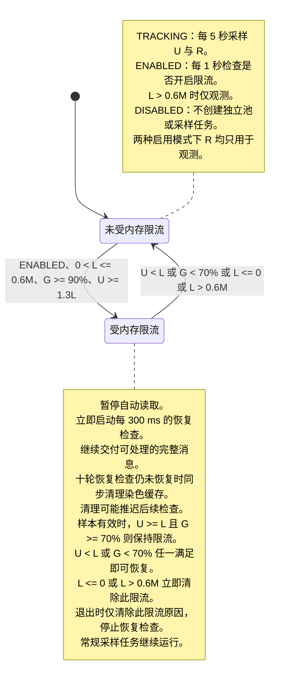

# PIP-499：使用 allocator 内存统计对明文 Broker 连接施加背压

> 中文审阅稿，对应[英文 PIP](pip-499.md)。配置项、指标名、单位与版本号保持一致。

# 背景知识

Producer 的一条小消息可能只是一个很大的网络 allocation 的视图。一次 socket 读取可以包含多条消息，
也可以只包含某条消息的一部分。帧解码阶段还可能合并多次读取，形成更大的缓冲区。
因此，一次 publish 完成并不意味着底层内存已经释放：其他消息、BookKeeper 写入、缓存 entry 或消费者发送仍可能持有它。

现有 publish 内存背压统计 pending publish 的逻辑字节数，entry cache 按 entry 长度统计大小，
两者都不能表示这些引用实际钉住的分配空间。调低 payload 上限可能改善某种负载，
但 payload 字节数与被持有 allocation 的关系，会随消息大小、接收批次和引用生命周期变化。

最初的调查观察到 BookKeeper 响应缓慢时发生 direct-memory 耗尽。公开报告中的一次失败为
`OutOfDirectMemoryError`：申请 4 MiB 失败，已用内存和最大内存均为 2 GiB。
这属于分配预算耗尽，应与原生内存申请失败以及 OS/容器 OOM kill 区分。
原始复现条件保留在[补充说明](#原始问题的复现)中；它们复现的是原问题，不是本次修订方案的行为。

Netty 区分活跃 buffer 钉住的内存与内存池保留的空间。释放 buffer 后，空间可以复用，
但空闲 chunk 不必立即归还底层分配器或操作系统。分配规格、线程缓存和碎片也影响内存池占用。
原生分配器与操作系统内存策略还会影响 RSS。本提案不测量或约束进程 RSS。

| 符号 | 定义 |
| --- | --- |
| `U` | 当前 broker 的共享明文 channel allocator 中，仍被活跃 buffer 钉住的 direct memory，包含分配规格取整及活跃 huge allocation。 |
| `R` | 同一个 allocator 当前仍保留的 direct memory，包含活跃分配、可复用空间、allocator 缓存、碎片以及活跃 huge allocation。它是当前保留量，不是历史申请累计值。 |
| `L` | 当前正数 `maxMessagePublishBufferSizeInMB` 换算后的字节阈值。非正数关闭这项额外限流。 |
| `M` | Netty 实际生效的全局 direct-memory 上限，单位为字节，包含适用的 `io.netty.maxDirectMemory` 覆盖；它与 `G` 使用同一个上限。 |
| `G` | 当前 broker 的 Netty 全局 direct-memory 使用率：Netty 当前全局 direct-memory 用量除以 Netty 实际生效的 direct-memory 上限，包含适用的 `io.netty.maxDirectMemory` 覆盖。`G >= 90%` 表示用量至少达到该上限的 0.9 倍。 |

`U` 不是消息 payload 长度之和，也不是 pending publish 字节数。缓存和消费者发送可以在原始 publish 完成后继续持有 allocation。
共享同一 allocation 的视图由 allocator 统计一次。`R - U` 较大不自动意味着泄漏。
`G` 使用 Netty 全局 direct-memory 计数器的统计范围，包含请求池之外使用同一计数器的分配。
它不包含 Netty 统计范围之外的内存、heap 或进程 RSS，也不只是请求池的 `R`。

# 动机

当存储或消费者变慢时，运维人员需要看清并控制明文请求处理所持有的 direct memory。
逻辑 publish 用量可能仍低于配置预算，但少量小消息已经钉住大得多的分配空间。
如果同时暂停已经收到的消息，又可能阻止这些 allocation 经处理完成而释放。

本提案通过独立内存池识别分配归属，不再额外维护每个 buffer 的引用计数。
它限制后续自动读取，同时让已解码的完整消息继续处理，并在十轮恢复检查仍未恢复时同步清理染色缓存，以释放长期缓存引用。

“染色缓存”指 publish 在正常缓存复制关闭时，以共享 buffer 方式插入并打标的缓存 entry。
该标记表示清理候选，不精确表示 allocator 归属，可能包含请求池之外的数据。
目标是在正常情况下保留共享优势、降低内存耗尽风险。这是软背压，不保证 broker 一定不会 OOM。

# 目标

## 范围内

- 使用一个 broker 级 allocator，统计明文 channel 的活跃与保留 direct memory。
- 提供仅观测模式，以及显式开启的 broker 级额外限流。
- 仅在 `0 < L <= 0.6M` 时允许限流：在 `G >= 90%` 且 `U >= 1.3L` 时暂停后续自动读取，在 `U < L` 或 `G < 70%` 时恢复；更大的正数限制仅允许观测。
- 仅受本机制限流时，让已经解码的完整消息继续处理。
- 正常共享缓存数据，在十轮恢复检查仍未恢复时同步清理染色缓存。
- 动态数字阈值影响已有和新建的适用连接，并通过指标反映结果。

## 范围外

- **TLS 连接不适用本机制。** 它们保留原有 allocator，不切换到本提案的独立池；也不应用本机制的读取限流，现有背压机制继续生效。
- 在同一个 JVM 中为多个 broker 实例运行本机制。
- 关闭 pinned tracking 后运行本机制，包括通过 chunk、subpage 或线程缓存统计估算活跃用量。
- 严格的请求准入预留、全部 broker direct memory 上限，或进程/容器 RSS 上限。
- 按 topic、producer 或 connection 划分的内存预算与指标。
- 内存压力下，仅为回收帧缓冲区而丢弃未完成请求或关闭连接。
- 调整通用接收 buffer 大小策略、原生分配器或操作系统内存设置。
- 从总内存中减去 BookKeeper 或固定比例的 entry cache，以此估计请求内存。

# 总体设计

Broker 在 `TRACKING` 或 `ENABLED` 模式通过共享池统计明文 channel 的分配，仅在 `ENABLED` 且 `0 < L <= 0.6M` 时允许本内存限流。
限流期间暂停后续自动读取，让可交付的完整消息继续处理，十轮恢复检查仍未恢复时同步清理染色缓存。
清理与采样在同一控制线程执行，清理耗时可能推迟后续检查。未完成的客户端请求在原有帧解码与连接策略下有意保留。
是否解除限流取决于本轮内存样本及最新限流资格；保留内存 `R` 仅用于诊断。

通过 `inProgressRequestFrameMemoryLimitEnabled` 在 broker 启动时选择模式，默认 `DISABLED`；修改模式需要重启。
`TRACKING` 与 `ENABLED` 要求开启 pinned tracking；核对的 Netty 版本默认开启。
本次修订不支持在关闭 pinned tracking 时使用这两种模式。`ENABLED` 还要求启动时 Netty 全局 direct-memory 统计可用；
否则拒绝启动，并打印冲突配置和解决方法。

| 模式 | 行为 |
| --- | --- |
| `DISABLED` | 保留普通分配路径，不增加独立池、采样任务、延迟缓存清理或新指标。 |
| `TRACKING` | 使用独立明文池并上报内存指标，不执行此内存限流或延迟缓存清理。 |
| `ENABLED` | 仅在 `0 < L <= 0.6M` 时允许内存限流及压力处理，否则仅观测。 |

限流资格要求 `0 < L <= 0.6M`，包含恰好等于 `0.6M` 的情况。配置为 `ENABLED`、但 `L > 0.6M` 时，
只保留观测行为：不执行本机制的限流、恢复任务或压力缓存清理。不会仅因这项资格保护而拒绝启动，
也不改写启动模式或数字配置；启动统计校验仍然适用。
启动时及数字更新导致进入该行为时，打印包含 `L`、`M` 和“仅观测”状态的警告日志。
显式配置的 `TRACKING` 始终仅观测，`DISABLED` 保持原有含义。下文所有限流与压力处理均以具备该资格为前提。

Broker 以 `TRACKING` 或 `ENABLED` 启动时，为明文 channel 创建一个共享 allocator，并在这些 channel 开始读取前安装。
Socket 接收、帧缓冲区合并与扩容、上游协议头处理均使用这个池。
这保留了入站数据原有的共享关系，不会仅为接收记账而额外复制数据。
TLS channel 保持普通 allocator，不施加本机制的读取限流。但只要仍有持有者（包括 TLS channel 的发送者）
引用请求池中的 allocation，它就继续计入 `U`；排除 TLS 连接不表示排除这些引用。

Allocator 自己跟随 allocation 的生命周期记账。派生视图、存储写入或缓存引用仍然存在时，allocation 继续计入；
最后一个持有者释放后才下降。帧解码层不包装 buffer，也不维护另一套 root 引用计数。
接收与帧解码沿用 Netty 原有控制流程，本机制不新增 decoder 主动补读逻辑。
本机制有意保留未完成请求，不为回收这部分内存而丢弃 buffer 或关闭连接；对应 allocation 仍完整计入 `U`。

消费者合并发送新建的 buffer 统一使用 `PulsarByteBufAllocator.DEFAULT`，使其与客户端请求接收缓冲在分配归属上分开。
现有 JVM 参数 `pulsar.allocator.default.type` 决定这些新分配所属的后端。

每个 broker 的常规任务采样 `U` 与 `R`：`TRACKING` 模式每 5 秒一次，`ENABLED` 模式每秒一次。
`ENABLED` 的开启与恢复检查同时取得当前全局使用率 `G`。当 `0 < L <= 0.6M`，且同时满足
`G >= 90%` 与 `U >= 1.3L` 时，对全部适用连接开启内存限流；仅 `U` 较高不能开启本限流。

开启时立即启动一个额外的 broker 级恢复任务，限流期间每 300 ms 采样并检查是否恢复。
当 `U < L` 或 `G < 70%` 时，仅清除本机制的限制并停止恢复任务，常规任务继续运行。
`G = 70%` 且 `U >= L` 时仍保持限流。所有适用连接的队列交付仍遵守其他业务背压；
第十轮恢复检查仍未恢复时，在本次恢复检查中同步清理染色缓存，结束后才返回。
清理与采样共用控制线程，因此后续检查可能晚于标称的 300 ms 间隔。
其他限流原因继续有效；`R` 仅上报供诊断使用，不作为独立限流输入。

例如，`M = 2000 MiB`、`L = 1000 MiB` 时具备限流资格；`G = 92%`、`U = 1300 MiB` 会开启限流，包含 `U` 恰好达到 1.3 倍阈值的情况。
`G = 80%` 时，即使 `U = 1600 MiB` 也不会开启本限流。已开启后，`U` 严格低于 1000 MiB，或 `G` 严格低于 70%，任一满足即可恢复。
`U = 1000 MiB` 且 `G = 70%` 时继续限流。没有其他限制阻挡交付时，队列中的完整消息仍能进入正常处理。
十轮恢复检查仍未解除限流时同步清理染色缓存，新缓存插入继续遵循配置的正常行为。
淘汰 512 MiB 的 entry，并不表示请求池已经释放了 512 MiB。

原有 payload 字节、pending 请求数、topic 速率及其他背压继续生效。
新机制增加一种限流原因，不替代已有计数器和恢复判断。

# 详细设计

## 设计与实现细节

### 分配覆盖与统计边界

本提案仅支持一个 JVM 中运行一个 broker。适用连接共享一个独立的请求 allocator，
可按固定名称注册为 JVM 级单例，不按连接创建。默认 `DISABLED` 时，不创建或注册该池。
池及其线程缓存沿用现有 allocator 和线程的生命周期，
本提案不增加多 broker 隔离、allocator 注销或专用线程缓存清理机制。

必须同时覆盖 socket 接收分配和帧缓冲区合并、扩容时的新分配。
只覆盖帧替换路径会漏掉直接使用的输入 buffer；只覆盖接收会漏掉从其他池分配的替换 buffer。
PROXY protocol 缓冲以及其他受支持上游分配路径也必须保持覆盖。

采样设计使用固定 pooled-direct 后端，其配置继承、明确的例外和启动校验见下文“内存池配置与启动校验”。
不能直接换成 unpooled 或 adaptive allocator，并假定仍具有本文定义的统计语义。

只要存储、缓存或下游发送者仍持有请求 allocation 的视图，allocator 就继续统计。
替换 channel allocator 不会迁移以前分配的 buffer；显式选择其他 allocator 的分配也仍属于原池。
因此，在 channel 初始化时就选择该池，不是在检测到压力后才临时切换。

ACK、FLOW、PING 等非 publish 入站数据也会进入接收池。
小 heap buffer 发送时转换成 direct buffer，以及一次性的 PROXY 检测开销，已接受为统计噪声，无需单独隔离。
消费者合并发送新建的出站 buffer，必须统一显式使用 `PulsarByteBufAllocator.DEFAULT`，
不随 entry 所属的 BK client 或 storage class 改变；自定义 BK allocator 也不改变这部分输出分配的选择。
它是标准 BK client 工厂及其他 Pulsar 通用操作共享的默认 allocator，不是消费者或存储侧专用内存池。
这使新建输出分配与客户端请求接入侧（`client -> broker`）分开，避免其直接推高请求池的 `U` 而触发发布背压。

现有 JVM 参数 `pulsar.allocator.default.type` 决定这些新输出分配的后端与内存池归属。
例如，通过 `-Dpulsar.allocator.default.type=pooled` 从 `adaptive` 切换为 `pooled` 后，新建合并发送 buffer 将归入 `DEFAULT` 的 Netty pooled 后端。
该修改影响所有使用 `PulsarByteBufAllocator.DEFAULT` 的组件，而不只是消费者发送。
参数在该 allocator 初始化时读取，需要重启 broker 才能生效；修改参数不会迁移已有 buffer，也不会将其切换到独立请求池。
即使两个后端都为 pooled，请求池仍是另一个实例。本 PIP 不新增输出 allocator 配置项。

无论 entry 来自 BK 读取、缓存命中还是刚完成的 publish，合并发送新建的 buffer 均使用 `PulsarByteBufAllocator.DEFAULT`。
更改新出站 buffer 的分配位置，不会迁移或释放原 entry buffer。
发送者、缓存或存储操作仍持有请求池 allocation 时（包括不复制原数据的投递），它继续计入 `U`，直到最后一个引用释放。

### 内存池配置与启动校验

初始实现固定请求池后端，在适用连接开始读取前验证统计能力。
现有分配设置继续复用，但后端选择、线程缓存大小和 heap fallback 明确采用例外规则。
以下 allocator 设置仅作用于新请求池，现有 allocator 保持原有配置与分配策略。

1. **固定 pooled-direct 后端。** 请求池不继承 `pulsar.allocator.type` 或 allocator 专属类型覆盖；
   这些类型选择继续作用于其他 allocator。本次不新增请求池的后端选择配置。
2. **继承池参数，线程缓存减半。** 复用 Netty 实际生效的 arena 数量、page/chunk 大小、对齐、
   可使用缓存的线程策略和缓存清理设置。仅新请求池的 small、normal 缓存条目数按对应现有配置减半，
   原值为零时保持禁用，实际队列容量遵循 Netty 的取整规则。按核对的默认值，分别为 256 → 128、64 → 32。
   不新增请求池专属调优配置，也不修改其他 allocator 的缓存。
   缓存按 allocator 与分配线程维护，这些条目数针对每个分配规格，不是字节预算。
   只将新池减半可以控制额外保留量，但不能保持原有总缓存预算，也不保证 `R` 减半。
   已释放并进入线程缓存的区域不计入 `U`。以二分之一作为初始默认值，通过吞吐、尾延迟、CPU 和 `R` 的压测验证取舍。
3. **明确 OOM 与泄漏检测行为。** 普通请求分配保留现有 OOM 通知和配置的 OOM 退出行为，
   包括适用的 allocator 专属设置；泄漏检测沿用全局策略。
   请求池不继承 heap fallback：direct 分配失败沿正常错误路径处理，不把压力转入 `U`、`R` 之外的 heap。
   这是对共享 heap fallback 设置的明确例外。压力清理通过淘汰缓存项释放引用，不分配 payload 副本，因此不需要恢复复制专用分配入口。
4. **校验真实统计能力。** 要求实际后端为 pooled-direct、至少有一个 direct arena，
   direct 分配确实池化，且 `U`、`R` 均为可用的非负统计。allocator 类型名或当前系统属性值本身不足以证明能力。
   direct arena 实际数量为零时明确拒绝，不能偷偷修改配置，也不能接受分配成功但统计未知的 unpooled direct 路径。
   在有关闭开关的版本上，显式 `io.netty.trackPinnedMemory=false` 与 `TRACKING`、`ENABLED` 不兼容。
   不通过修改该全局属性来强制开启 tracking，因为 Netty 可能已经初始化静态策略。
5. **小块分配启动探针与诊断。** 在适用 channel 开始读取前、请求池尚无并发使用者时，
   记录 `U`，分配并持有一个确实走 pooled-direct 路径的小块 buffer，验证 `U` 增加，最终释放后回到基线。
   失败路径也必须释放探针。增量不要求等于申请长度，因为存在分配规格取整。
   不能使用 huge allocation 作为唯一探针：即使 pooled pinned tracking 关闭，huge allocation 仍可能被计数。
   释放后不要求 `R` 回到基线；首次小块分配可能保留一个完整 chunk，需要接受并计入这项启动成本。
   统计不可用或探针失败时，`TRACKING`、`ENABLED` 必须以清晰错误拒绝启动；`DISABLED` 不创建请求池或探针。
   启动诊断记录实际后端、direct arena 数量、chunk 大小、派生缓存大小、明确的配置继承例外和验证结果。

`ENABLED` 还必须在接受连接前校验全局 direct-memory 统计：Netty 当前全局用量必须可用且非负，实际生效的上限必须为正数。
校验失败属于启动配置冲突，即使当前 `L <= 0` 或 `L > 0.6M` 暂不允许限流，也必须拒绝启动，不能静默降级模式，
避免后续动态修改限制时才暴露不支持的配置。请求池探针成功不能代替这项全局统计校验。

启动错误必须指出 `inProgressRequestFrameMemoryLimitEnabled=ENABLED`、不可用或无效的全局用量或上限，
以及相关冲突 Netty 配置及其值，例如 `io.netty.maxDirectMemory=0`。
同时说明解决方法：删除或修正冲突设置后重启，或改用 `TRACKING`、`DISABLED`。
修正设置后仍需重新校验真实计数器，不能仅凭属性值已改变就通过。
`TRACKING`、`DISABLED` 不要求全局统计可用；`TRACKING` 仍须通过上述请求池统计校验。

### 活跃内存与保留内存的采样

每次请求池采样指读取一次独立 allocator 当前的内存统计：pinned direct memory `U` 用于限流决策，reserved direct memory `R` 用于诊断。
本次修订要求开启 pinned tracking，不实现关闭 tracking 后的估算路径。
`ENABLED` 的开启与恢复检查都成对读取 Netty 当前全局 direct-memory 用量与实际生效的 direct-memory 上限，计算 `G`，不复用旧指标样本。
上限包含适用的 `io.netty.maxDirectMemory` 覆盖；不将 Netty 用量除以 JVM direct-memory 上限，也不回退到 JVM 或 direct-buffer-pool 指标。
通过启动校验后，运行期采样失败、Netty 用量计数器不可用或为负数，或上限为非正数时，`G` 不可用，按下文输入采样失败规则处理。
不将 `R` 与 `L` 比较。池保留的空闲区域可能计入 Netty 全局用量，但开启仍需满足 `0 < L <= 0.6M`，并同时满足 `U >= 1.3L` 与 `G >= 90%`。

独立采样 `U` 与 `G`；不可用或无效的输入打印日志并重试，不能当成零或使用旧值。
开启需要本轮两项输入同时满足条件，任一采样失败均不能新开启限流。
恢复只需一项有效条件：本轮 `U < L` 可在 `G` 不可用时恢复，本轮 `G < 70%` 也可在请求池采样失败时恢复。
无法确认任何恢复条件时，继续保持已开启的限流。

Pinned tracking 跟随 buffer 的分配和最终释放，包含分配规格取整及 huge allocation。
核对的 Netty 版本默认开启，因此无需显式设置系统属性。
对于允许关闭 tracking 的版本，`io.netty.trackPinnedMemory=false` 与 `TRACKING`、`ENABLED` 不兼容。
如果 pinned tracking 被关闭或不可用，启动校验必须拒绝这两种模式，并报告清晰的配置错误。
`DISABLED` 不要求开启 pinned tracking。统计失败必须可观察，不能悄悄当成零用量。

`R` 按与 `U` 相同的 direct-memory 范围，包含当前保留的池化 chunk 和活跃 huge allocation。
空闲 chunk 仍计入 `R`，历史累计申请次数不计入。
本策略不包含 `R > 1.1L` 条件，也不使用其他将此池 `R` 与 `L` 比较的开启分支；恢复同样不检查 `R`。

### 完整消息的交付

Socket 接收与已解码消息的交付分别决策，两者都要求连接有效且 broker ready：本内存限流暂停自动读取，但允许队列中的完整消息继续处理；其他业务限流仍可暂停交付。
Broker 通过回调向流控组件提供交付许可，common 模块不直接依赖 broker 的具体限流类型：

| 当前限流原因 | 自动读取 socket | 交付队列中的完整消息 |
| --- | --- | --- |
| 无 | 允许 | 允许 |
| 仅本内存限流 | 暂停 | 允许 |
| 仅其他业务限流 | 暂停 | 暂停 |
| 本内存限流与其他业务限流同时存在 | 暂停 | 暂停 |

在连接所属 eventLoop 上主动排空可交付的队列，延迟到当前 pipeline 回调返回后执行。
同一连接最多一个待执行排空任务，合并请求以避免重入交付，不增加定时任务。
没有后续输入时，只是允许交付并不足以唤醒队列。
特别是其他业务限流已经解除、但内存限流仍在时，即使自动读取仍关闭，也必须触发队列交付。
每交付一条消息后重新检查策略。排空队列既不能临时开启自动读取，也不能在队列变空后继续请求 socket 数据。

每个排空任务在同一次调用中持续交付，直到队列为空或当前交付策略要求停止，包括其他业务限流重新生效的情况，
不等待每条 publish 完成。业务背压暂停交付后，由正常的策略变化通知在允许时继续排空剩余队列。
不新增每次交付条数或时间片预算，也不为了让出 eventLoop 而拆成多轮、增加续执行调度。

不增加分轮调度是有意的取舍。原有 `maxMessagePublishBufferSizeInMB` payload 限流继续管理在途 publish 的逻辑字节预算，
pending 请求数、速率及其他业务背压也继续生效。本 allocator 机制增加 socket 读取背压，不替代这些控制，也不再增加一套队列交付预算。
如果没有业务限制暂停交付，大队列的一次排空可能占用 eventLoop，延后其他连接或已排队通知的处理；
为保持交付逻辑简单，本方案接受这项成本。原有 publish 限制不是单次排空执行时间的严格上限。

### 有意保留未完成请求

本内存压力机制有意保留半包中的请求数据，不会仅因其持有 direct memory 就丢弃帧缓冲区或关闭连接，无论占用大小。

半包通常保存请求中已连续接收的部分数据，后续片段仍属于用户的待处理请求；allocation 的剩余容量也可能继续用于拼帧。
因此，这部分 buffer 是活跃请求状态，而非可以直接回收的空洞。这不表示每个分配字节都保存有效 payload：
分配规格取整和共享 allocation 的放大仍可能存在，allocator 仍将实际钉住的完整容量计入 `U`。
通过丢弃请求来回收 buffer 会丢失这些待处理数据，并要求客户端重试。

Netty 原有接收、解码器自身续读、最大 frame 长度检查和连接超时策略继续生效。
本机制不新增逐连接钉住容量检查、内存记账包装、主动半包补读或压力专属半包超时。
请求正常完成或连接正常关闭时释放相应引用；其他持有者仍可能继续钉住 allocation。

大量连接各自保留半包时，即使完整消息已经处理、染色缓存已经释放，`U` 与 `G` 仍可能不低于恢复水位，
而暂停读取又会阻止这些半包完成。接受这种情况是有意的取舍，本机制不保证总能自行恢复。
如果连接过多导致这一状态持续，说明连接总数与 Pulsar 部署的内存规格不匹配。
用户应扩容 Pulsar，包括增加 broker 并重新分布连接或增加 broker 内存，减少连接数，
或在部署支持时调整 Netty 的 `ChannelOption.RECVBUF_ALLOCATOR` 接收 buffer 分配策略。
该选项控制接收 buffer 的分配大小，不是 frame cumulation 的硬上限；本 PIP 不新增接收大小配置项或自动调优策略。
是否恢复仍以实际 `U` 与 `G` 为准。

### 正常共享缓存，第十轮恢复检查同步清理

本机制保持正常缓存共享，在第十轮恢复检查仍未解除内存限流时，于该次检查中同步清理染色项，不额外复制 payload 或将 entry 迁移到其他池。
`managedLedgerCacheCopyEntries` 保持独立的原有语义：`false` 共享 entry 数据，`true` 在正常缓存插入时复制。
压力不改写该配置，不强制额外复制，也不引入专用分配入口或复制预算。

Publish 插入缓存时，仅在 `managedLedgerCacheCopyEntries=false`、共享数据的新缓存 entry 上打标；
为 `true` 时正常复制，新 entry 不染色。同一次插入的复制与染色决策使用同一次配置读取结果。
存储读取插入不设置标记。正常缓存复制保留原有分配与失败策略，不进入特殊的恢复复制路径。

布尔字段放在实际缓存 entry 上，发布到缓存前完成初始化；创建和回收时均重置为 `false`。
`L` 暂时为非正数或因 `L > 0.6M` 仅观测时，只停止限流与压力处理，不停止为适用的新插入染色，因此恢复限流资格时无需追溯补标。
不维护额外的长期 entry 引用索引，清理通过安全遍历当前缓存筛选染色项。

不为维护标记检查 allocator 身份、派生视图或 composite 组件，接受误标带来的额外缓存淘汰；限流决策仍使用实际测得的 `U` 与 `G`。

每次进入内存限流时，将恢复检查计数器置零。每轮 300 ms 的恢复任务先尝试取得新样本，按最新限制检查两个恢复条件；
失败的输入不能证明条件成立，但不阻止另一项有效输入确认恢复。若仍处于限流则累加计数。
第十轮仍未恢复时，将计数归零，并在本次恢复回调内同步清理 broker 各 entry cache 中的染色项。
此后每再经过十轮仍未恢复，就再次清理，以覆盖后来进入缓存的 entry。
常规每秒采样和数字限制更新不累加此计数。十轮约为三秒，实际时间受首次执行时机、调度、采样及此前清理耗时影响，不是严格期限。
清理不提交为独立后台任务，本次回调在清理结束后才继续。如果本轮已确认恢复，或控制线程已处理使限流资格失效的更新，则不开始清理。

没有有效输入确认恢复时，采样失败的恢复轮次仍计数是有意选择：已经进入内存限流后，不能因为统计暂时不可用，就无限推迟释放可能阻碍恢复的缓存引用。
失败的采样并不证明恢复条件仍未满足；如果实际用量已经下降，这项选择可能造成不必要的缓存淘汰、缓存未命中和存储读取。
清理本身不代表可以恢复读取：本轮有效样本满足恢复条件，或因 `L <= 0`、已确认的 `L > 0.6M` 失去限流资格时，才解除本限流。
失去资格时无需等待用量采样。
初始未限流的 broker 不会仅因采样失败就启动恢复轮次或压力清理。

清理通过安全的缓存淘汰移除染色项，只释放缓存持有的引用，保留未染色项；已有读者或存储操作持有的 entry 继续有效。
后续缓存未命中按正常路径从存储读取。维护已有缓存大小和淘汰统计，避免与普通淘汰并发时重复释放，
复用现有缓存锁、身份校验和引用释放流程。被淘汰的 entry 离开清理范围，对象回收时重置字段。
该字段不额外 retain entry 或 buffer，不替换缓存 payload，也不需要为迁移副本重建 metadata。

每个缓存的本轮遍历都有固定终点。清理开始遍历某个缓存时，只记录一次该缓存当时最大的 ledger/entry 位置；空缓存直接跳过。
本轮只遍历不超过该终点的位置，移除染色项、保留未染色项，不随新插入推进终点，也不反复遍历直到没有染色项。
追加到终点之后的 entry 留给后续清理。本规则限定的是遍历范围，不是严格的时间快照：并发插入到范围内的 entry
可能被本轮遍历到，也可能留待后续；未遍历到的染色项仍可在后续清理中移除。
只保存终点的位置值，不复制缓存内容，也不为构造快照额外 retain entry；后续每轮重新记录终点。

清理直接在执行采样、数字限制更新和控制器关闭处理的同一个 broker 控制线程上运行。
本轮清理结束后，该线程才处理下一项控制操作，因此清理不会重叠，也没有独立排队的清理任务，不需要清理代次校验。
配置更新和控制器关闭处理等待正在执行的清理完成。普通缓存插入、读取和淘汰仍可能并发，继续使用原有同步保护。
解除限流时重置检查计数。`TRACKING`、`DISABLED` 不触发此压力清理，新插入仍遵循配置的正常复制策略。

不额外引入分批预算是有意的权衡。固定终点只限定本轮遍历范围，不限制本轮移除条数或执行时间，也不是跨批次续扫游标。
本次复用现有淘汰流程，保持压力恢复路径简单，优先释放缓存引用，
不新增按条数或时间片划分的清理预算、续扫游标，以及额外的分批调度和配置。
接受大缓存清理可能带来的 CPU 消耗、缓存锁竞争和业务延迟，以及常规采样、300 ms 恢复检查、配置更新和控制器关闭处理的延迟。
以这些代价换取串行执行，避免独立清理调度和跨任务取消协议。清理的 CPU、持锁时间和执行耗时没有严格上限。

移除缓存项本身不代表恢复。其他 entry、读者或存储操作可能继续持有同一个 allocation，染色也可能包含请求池之外的数据。
继续采样，本轮有效的 `U < L` 或 `G < 70%` 任一满足时解除限流。
提高 `L` 后，即使 `U` 没有下降也可能恢复；非正数 `L` 或已确认的 `L > 0.6M` 均无需等待用量采样即可清除此限流原因。
清除缓存引用不保证 `R` 或进程 RSS 立即下降，并可能增加存储读取和缓存未命中。

### 调度、配置变化与关闭

采样、同步缓存清理、数字配置更新和控制器关闭在同一个 broker 控制线程上串行执行。
清理可能推迟后续控制操作，采样周期是标称间隔，不是严格期限。连接侧仍在各自 eventLoop 上应用最新状态。
本文所述“立即清除此限流”指控制线程处理到该更新时无需等待成功的用量样本，不表示抢占正在执行的清理。

每个 broker 使用一个常规采样任务：`TRACKING` 每 5 秒一次，`ENABLED` 每秒一次，`DISABLED` 不启动采样任务。
`ENABLED` 模式的每秒任务检查是否开启限流；开启时立即启动额外的 broker 级恢复任务，每 300 ms 采样并检查恢复。
恢复任务最多同时存在一个，在恢复或失去限流资格时停止，包括 `L <= 0` 或已确认的 `L > 0.6M`。
常规任务跨限流状态切换和数字限制更新继续采样指标。队列交付仍在连接 eventLoop 上执行，不阻塞控制线程；
同步缓存清理会推迟该线程上的后续检查。合并逾期的常规、恢复及配置更新采样请求，避免任务积压或集中补跑恢复轮次。
仅在决策变化时向连接发送更新通知，新激活的连接继承当前状态。
使用最新模式、限制与生命周期状态决策，任务取消或 broker 关闭后忽略过期结果。

控制线程处理数字限制更新时重新判断 `L/M` 资格。已确认 `L > 0.6M` 时，只清除此内存限流原因，
停止恢复任务、重置恢复轮次，并停止后续压力清理，即使用量采样失败也一样。
保留独立池、指标与正常缓存染色。常规采样周期仍由启动配置决定：配置为 `ENABLED`、因比例过高而仅观测时仍每秒采样；
显式 `TRACKING` 仍每 5 秒采样。不增加额外定时任务或配置值。
后续调回 `0 < L <= 0.6M` 时，只有配置为 `ENABLED` 的 broker 才会在新样本满足开启条件后重新限流。
此过程不改写启动模式，也不改写旧 payload 限流的行为。

连接状态变化在各自 eventLoop 上执行，包括 broker 已限流时新激活的适用连接。
连接初始化的读取设置不能覆盖已有的限流状态。
Readiness 变化和限流通知使用同一条决策路径：连接有效、broker ready 且业务限流与本内存限流均已解除，才允许自动读取。
ready 回调记录 readiness 后重新判断，不直接开启读取。排队通知执行时使用当前状态，不直接应用此前捕获的读取开关；
过期工作不能覆盖新决策，连接关闭后待执行回调失效。
数字限制更新应请求新样本，并按最新限制重新判断用量，不依赖新的入站流量。
具备限流资格时，仅用本轮成功取得的输入判断开启或任一恢复条件，不复用旧样本。提高限制后，即使用量没有下降，新的成功样本也可能允许恢复。
非正数限制立即清除此限流原因，即使本轮采样失败或尚无成功样本也一样。

任一输入采样失败时打印日志并持续重试，不能让后续检查停止。缺少开启所需的输入时不能开启；
已限流时，若另一项本轮有效输入确认恢复，或已确认数字更新使限流资格失效，则解除，否则保持状态。初始状态为未限流。
保留最后成功值及其原始时间戳用于指标和诊断，不用于新的限流决策，因此无需定义样本最长复用时间或过期策略。
首次成功采样前不观测 `U`、`R`，不能把未知用量报成零。这个运行期策略不削弱启动时的统计能力校验。

控制器关闭在控制线程上处理，等待正在执行的清理结束后，将控制器置为关闭并取消常规、恢复采样，
阻止排队的检查或连接通知重新启动它。
关闭本组件持有的指标注册或观测回调。共享池及其线程缓存沿用上文所述的现有 allocator 和线程生命周期；
其他持有者仍引用的 buffer 保持有效，直到正常最终释放。

每秒一次的限流开启检查仍是软背压，不是严格的内存上限。需要为采样周期、调度、采样和缓存清理耗时、连接实际暂停读取前的内存净增长，
以及已读数据的后续处理、正常接收和 cumulation 扩容保留空闲 direct-memory 余量。
降低 `L` 可以恢复限流资格，或使 `U` 的开启条件更容易满足；在这些条件已满足时，仍需等到 `G >= 90%` 才会开启，降低 `L` 不会让全局压力门槛提前。
应评估剩余容量能否覆盖下一次检查及暂停读取生效前的内存净增长，余量不足时增加可用内存配额。
这里的余量指总 direct-memory 预算中尚未占用的容量，某个 allocator 保留的空闲 chunk 不等于全局可用容量。
其他池的分配（包括普通 TLS 分配）不受此池预算约束。

## 面向使用者的变更

### 配置

本提案新增一个启动模式配置，并继续使用现有动态内存阈值和缓存复制配置；消费者合并发送同时受现有默认 allocator 类型参数控制。
模式修改需重启，`L/M` 资格决定配置为 `ENABLED` 的 broker 实际限流还是仅观测。

| 配置项 | 类型、默认值、范围与行为 |
| --- | --- |
| `inProgressRequestFrameMemoryLimitEnabled` | Broker 启动枚举：`DISABLED`（默认）、`TRACKING`、`ENABLED`。修改需要重启。`DISABLED` 保留普通分配路径，不增加本 PIP 的池、任务、延迟缓存清理和指标；`TRACKING` 使用明文池并采样指标，不执行此限流或延迟缓存清理；`ENABLED` 仅在 `0 < L <= 0.6M` 时允许限流，更大的正数限制仅观测且不改写启动模式。具备资格时，在 `G >= 90%` 且 `U >= 1.3L` 时开启，在 `U < L` 或 `G < 70%` 时恢复，并增加压力处理。所有模式下，TLS channel 均保持普通 allocator，不被本策略暂停读取。 |
| `maxMessagePublishBufferSizeInMB` | 现有 broker 整数配置，单位 MiB。保留其默认值：JVM direct-memory 上限的一半，最小 64 MiB。新机制共用一个 broker 级 `L`；动态更新影响已有与新建的适用连接，无需重连。非正数关闭并清除本额外限流；`L > 0.6M` 时本机制仅观测，调回范围后只有配置为 `ENABLED` 才可重新限流。旧 payload 限流保留已有行为，包括创建连接时取得的配置快照。 |
| `managedLedgerCacheCopyEntries` | 现有 broker 动态布尔配置，默认 `false`；更新影响后续缓存插入。`true` 保持正常复制，`false` 保持正常共享，内存限流期间也不变。本机制不改写配置、不强制压力复制；仅在本次插入使用 `false` 时为新 publish 缓存 entry 染色，复制后的新 entry 不染色。动态更新不追溯修改已有标记；具备限流资格的 `ENABLED` 下，十轮恢复检查仍未恢复时，即使当前已开启正常复制，也同步清理已有染色项。不要求精确追踪 allocator 归属。 |
| `pulsar.allocator.default.type` | 现有 JVM 系统属性，以 `-Dpulsar.allocator.default.type=<value>` 传入；支持 `pooled`、`adaptive`、`unpooled`。核对工作树的启动脚本显式选择 `adaptive`。省略设置时按下文顺序解析，只有相关类型和旧配置均未设置时，才使用内置默认值 `pooled`。它选择 `PulsarByteBufAllocator.DEFAULT` 的后端，影响消费者合并发送新建输出及其他所有使用该 allocator 的组件；修改后重启 broker，会改变这些分配的后端与内存池归属。它不改变独立请求池固定的 pooled-direct 后端，也不会将这些输出分配计入请求池。 |

`PulsarByteBufAllocator.DEFAULT` 按以下顺序选择后端，采用第一个已设置的值：

1. `pulsar.allocator.default.type`。
2. `pulsar.allocator.type`。
3. 已废弃的 `pulsar.allocator.default.pooled`。
4. 已废弃的 `pulsar.allocator.pooled`。
5. 以上均未设置时，使用内置默认值 `pooled`。

两个旧配置中的 `true`（忽略大小写）选择 `pooled`，其他值选择 `unpooled`；显式类型配置优先于这两个旧配置。
核对工作树的启动脚本设置了 `pulsar.allocator.default.type=adaptive`，因此仅设置通用的 `pulsar.allocator.type` 不能覆盖它。

`TRACKING` 与 `ENABLED` 要求开启 pinned tracking。在提供关闭开关的 Netty 版本上，
显式设置 `io.netty.trackPinnedMemory=false` 会使这两种模式成为无效配置；启动时必须报告清晰的配置错误。
`DISABLED` 仍然有效。本次不提供估算回退路径。

`ENABLED` 还要求 Netty 全局用量计数器可用且有效、实际生效的上限为正数，否则不论当前 `L` 为何值均拒绝启动，
错误中必须打印冲突配置，以及修正配置或改用 `TRACKING`、`DISABLED` 的解决方法。
这两种模式不要求全局统计可用，但 `TRACKING` 仍要求请求池统计有效。

请求池的启动选择见“内存池配置与启动校验”：固定 pooled-direct，继承池参数但将 small/normal 线程缓存条目数减半，
并禁用 heap fallback。这些例外只作用于请求池，其他 allocator 保持已有设置。

修改 `managedLedgerCacheCopyEntries` 影响后续插入及其染色决策，不清空缓存、不追溯复制或重新标记已有 entry。
改为 `true` 后，已有染色项仍可进入第十轮检查执行的清理范围；改为 `false` 后，已有未染色项保持未染色。
配置修改不单独启动清理，第十轮触发的缓存清理仍是内存控制器的独立动作。

限流资格要求 `0 < L <= 0.6M`，开启还需同时满足 `G >= 90%` 与 `U >= 1.3L`；`L > 0.6M` 时只观测。
`TRACKING` 每 5 秒采样一次；`ENABLED` 每秒检查是否开启限流。
仅在限流期间，额外的恢复任务每 300 ms 检查一次。`U < L` 或 `G < 70%` 任一成立即可恢复；
`U = L` 且 `G = 70%` 时继续限流。上述比例为固定规则，不新增配置。
第十轮恢复检查仍未恢复时同步清除染色缓存，必要时每十轮重复；轮数同样固定。
清理耗时可能使后续采样和恢复检查超过标称间隔。

### 指标

以下均为 broker 级 gauge，不新增指标专属标签；沿用已有的 broker/resource 身份属性。
usage 与 reserved 仅描述独立池，与谁持有池中 allocation 无关；不包含其他池的分配，也不表示全部 broker direct memory。
throttled 上报本策略决策；`G` 使用 Netty 匹配的全局用量与生效上限，不使用现有 JVM 指标的比值，也不新增使用率指标。

| 指标 | 含义 | 单位 |
| --- | --- | --- |
| `pulsar.broker.publish.in.progress.buffer.memory.usage` | 最近一次采样的 pinned 用量 `U`，包含仍被缓存或消费者发送持有的活跃请求池 allocation。 | 字节（`By`） |
| `pulsar.broker.publish.in.progress.buffer.memory.reserved` | 最近一次采样的 `R`，包含当前保留的 chunk 和活跃 huge allocation，仅用于观测。 | 字节（`By`） |
| `pulsar.broker.publish.in.progress.buffer.memory.throttled` | 指标采集时 broker 对本限流原因的当前决策：开启为 `1`，否则为 `0`；独立于其他限流原因。 | 无量纲（`1`） |

`TRACKING` 与 `ENABLED` 注册全部三个指标；`TRACKING`，以及因 `L > 0.6M` 而仅观测的 `ENABLED`，throttled 始终为零。
`DISABLED` 不注册任何一个。已注册的 `U`、`R` gauge 在首次成功采样前不产生观测；
之后使用最近一次成功值，不按消息实时更新，采样失败时保留该值，内部保留原始采样时间供诊断。
正常更新周期在 `TRACKING` 为 5 秒，在未限流的 `ENABLED` 为 1 秒，在已限流的 `ENABLED` 为 300 ms，
还要加上调度、采样及同步缓存清理的延迟；连续失败时，上报值可能保持更长时间不变。

throttled gauge 在指标采集时读取 broker 的当前限流决策，包括数字限制更新引起的变化，
不使用上次内存采样时缓存的状态；这不表示每个连接都已经在各自 eventLoop 上应用了通知。
保留的指标值没有额外过期规则，也不复用于新的限流决策；不能把未知用量表示为零。
启动诊断应说明统计方法与明文 channel 的分配覆盖范围。
采样失败必须打印日志，运维人员通过现有日志系统识别该情况并配置告警。
不新增最近成功采样时间、样本年龄或采样失败计数指标；缓存清理错误同样必须可观察。

# 监控

结合请求池内存指标、限流状态、现有业务指标和日志，判断限流是否按规则生效、恢复，以及缓存清理的成本。
解读这些观测时，应同时考虑统计边界和采样延迟。

先检查 `0 < L <= 0.6M` 是否具备限流资格；“仅观测”警告说明比例不满足要求。
具备资格时，将 `U` 与开启阈值 `1.3L`、恢复阈值 `L` 对照，同时观察 `G` 相对 90% 开启水位和 70% 恢复水位的位置。
观察限流持续时间，并关联 BookKeeper 写入延迟、publish 完成延迟、消费者投递与缓存行为。
Publish 已完成但 `U` 仍高，可能是缓存或发送者仍持有引用。
观察第十轮清理的执行耗时及后续 `U` 样本；淘汰 entry 的数量或字节数不能证明其 allocation 已经可复用。
如果相关引用释放后仍持续限流，应检查连接保留的未完成请求是否主导 `U`，结合连接数和 broker 内存规格评估容量，
并采用上述扩容、减少连接或调整接收分配策略的措施；缓存清理不能回收这些请求 buffer。

将 `R` 与 `U`、direct-memory 总用量一起观察。`U` 低而 `R` 高时，应排查池保留与碎片，但这不会维持本机制的限流。
混合明文/TLS broker 要单独考虑池外的分配，包括普通 TLS 分配。
广泛启用前，应测量缓存命中与淘汰、增加的 BookKeeper 读取和清理工作量。

当前限流资格比例、开启倍数与恢复水位是初始规则。后续可依据本提案新增的活跃用量、保留量与限流状态指标，
观察真实工作负载下的内存变化、限流频率和持续时间，并结合已有的吞吐与延迟数据，
在后续修订中评估并调整限流规则。

# 向后与向前兼容

## 升级

默认 `DISABLED` 保留现有分配与背压行为。运维人员可以先重启为 `TRACKING`，观察适用池，再决定使用 `ENABLED`。
启用前需确保 Netty 全局统计可用且实际生效的上限为正数，否则 `ENABLED` 拒绝启动，并打印配置诊断和解决方法。
实际限流还需 `0 < L <= 0.6M`；更大的正数限制使 `ENABLED` 仅保留观测。
两种模式都会引入独立池，因此需要评估保留量与缓存行为。数字限制对本机制支持动态更新。
已有客户端无需修改二进制协议，持久化 metadata 和 ledger 格式不变。
帧解码和已有连接超时策略保持原有行为。本内存压力机制保留未完成请求，不为回收其 buffer 而新增关闭连接的行为。

## 降级与回滚

重启并设为 `DISABLED` 可恢复普通分配路径；降级到不识别新配置的版本前移除该配置。
缓存清理只影响内存中的缓存项，没有需要撤销的持久化格式转换。
更换或关闭池不会转移活跃 buffer，也不会强制原生内存立即归还。

# 备选方案

本提案将 allocation 记账交给 Netty，保留正常 buffer 共享，通过暂停新增读取和延后淘汰缓存减轻压力。
这一选择避免额外的逐 buffer 记账或压力复制，接受软限制及额外缓存未命中的代价。
下面对比其他方案的取舍，并区分仍可并行推进的互补措施。

- **逐 root 的记账包装。** 可以追踪引用生命周期，但会在接收路径额外维护一层引用统计。本次修订将归属记账交给 allocator。
- **复制每个已解码 frame。** 复制到请求池可以减少大 allocation 放大，但缓存仍可能持有请求池的小 buffer；复制到其他池又会将后续在途内存移出 `U`。本次修订保留正常共享，在必要时通过延迟淘汰释放缓存引用，避免为内存压力机制额外引入 payload 复制路径。
- **直接降低接收/cumulation 放大。** 更紧凑的累积大小、可配置的接收容量，以及只复制会钉住过大 allocation 的 frame，都可能减少浪费。应在相同复现负载下与额外限流比较；仅改用 allocator 记账，不会在正常运行时缩小这些 allocation。
- **始终复制缓存 entry。** 可隔离生命周期，但正常流量也要承担复制成本。运维人员仍可通过现有配置主动选择始终复制；本机制保留该配置行为，改为在十轮恢复检查仍未恢复时清理染色项。
- **压力下复制或迁移缓存数据。** 可以保留缓存命中，但需要目标内存余量、复制预算、安全替换和非致命分配策略。延迟淘汰避免这些复制与分配策略，代价是增加缓存未命中和存储读取。
- **调低 payload 限制或调整接收大小。** 仍是有用的互补措施，但不能约束 allocation 生命周期。[PIP-430](pip-430.md) 提出的接收大小配置化仍是独立工作。
- **根据保留 chunk 限流，包括 `R > 1.1L`。** 最后一个 buffer 释放后空闲 chunk 仍可能存在，从而无法恢复或反复触发。本次仅记录 `R`。
- **从 direct-memory 总量减去 BookKeeper 或一半缓存。** 分配持有关系有重叠，缓存来源不是固定各半，reserved 与 pinned 也不能互换使用。
- **内存限流时暂停队列中的完整消息。** 继续处理这些消息可能是释放阻碍恢复的 allocation 所必需的。本方案暂停新增接收，显式排空可交付的已有消息。

# 补充说明

## 本次修订核对的 Netty 兼容性

核对的 Netty 版本默认开启或始终开启 pinned tracking，无需显式设置 `-Dio.netty.trackPinnedMemory`。
下表的 Netty 4.2 快照允许关闭，但本次修订不支持在关闭后使用 `TRACKING` 或 `ENABLED`。
如果未来 Netty 修改默认值，再单独讨论是否支持关闭 tracking 的配置；本次不提供估算回退路径。
这里是已核对的快照，不代表最新发布版本或未来分支头。

| 核对的依赖快照 | Netty | Pinned tracking 行为 |
| --- | --- | --- |
| 提案工作树 | `4.2.19.Final` | 默认开启。Netty 允许设置 `io.netty.trackPinnedMemory=false`，但本次修订的 `TRACKING`、`ENABLED` 不支持此设置。 |
| [Pulsar `v4.0.14`](https://github.com/apache/pulsar/blob/v4.0.14/pom.xml#L187) | `4.1.138.Final` | 该版本始终开启，没有关闭属性。 |
| [`branch-4.0` 的 `2a3d32f7bbb72f866e7c3c198b32c349eea8e1f4` 快照](https://github.com/apache/pulsar/blob/2a3d32f7bbb72f866e7c3c198b32c349eea8e1f4/pom.xml#L187) | `4.1.140.Final` | 该版本始终开启，没有关闭属性。 |

Netty 没有将默认值从 false 改成 true：[#11990](https://github.com/netty/netty/pull/11990)
将记账从线程缓存活动修正为跟随 buffer 生命周期；之后 [#15436](https://github.com/netty/netty/pull/15436)
增加可选的 CPU 成本开关，最终仍默认 true。其他受支持版本需要分别核对。

## 验证状态与必要场景

已有实验仅证明组件路径的可行性。以下分开说明已完成实验及其局限，以及本方案仍需验证的启动、生命周期、恢复和性能场景。

### 已完成实验与局限

Allocator 归属和队列排空小实验只验证了所测组件路径的可行性。
完整 broker 的恢复、OOM 防护行为和本方案的吞吐量仍未验证。

早期逐 root 实现的固定负载测试报告：128 B 消息、20,000 msg/s、各变体三轮，
broker 每百万条消息 CPU 时间中位数增加 2.35%–3.40%。该测试没有触发内存限流，
也不衡量本次 allocator 统计、队列交付或缓存清理设计，不能用作本方案的性能或恢复验证。
早期工作的详情记录在 [PR #27110](https://github.com/apache/pulsar/pull/27110)。

### 启动与 allocator 统计

启动与统计检查需要区分各模式的要求，确认请求池与 Netty 全局计数器可用，才能依赖它们作出决策。

验证默认开启的 pinned tracking 支持 `TRACKING` 与 `ENABLED`。
在提供关闭属性的版本上，验证显式关闭 tracking 时，这两种模式均拒绝启动并报告清晰的配置错误，
而 `DISABLED` 仍可正常使用。

验证 `ENABLED` 在 Netty 全局用量计数器不可用或为负数、实际生效的上限为非正数时拒绝启动，即使请求池探针成功也一样。
覆盖 `-Dio.netty.maxDirectMemory=0`，以及具备限流资格、`L <= 0`、`L > 0.6M` 三类限制配置。
检查错误包含启动模式、失败的统计值、相关冲突配置及其值，以及删除或修正设置后重启、或改用 `TRACKING`、`DISABLED` 的解决方法。
修正后重新校验真实计数器，仅修改属性字符串不能绕过能力检查。
验证在符合各自其他启动要求时，全局统计不可用本身不会使 `TRACKING`、`DISABLED` 拒绝启动。

验证 direct arena 为零时，即使 direct 分配成功也拒绝启动。
验证小块 pooled 探针可以识别 tracking 不可用，不能被 huge allocation 的正数统计或之后修改的属性字符串误导。
检查继承参数、明确覆盖项、零值与自定义缓存配置，以及其他 allocator 行为不变。
验证普通分配的 OOM 通知和配置的退出行为，以及请求池不回退 heap。

验证 JVM 与 Netty 上限不同时，`G` 使用 Netty 匹配的用量与生效上限。
例如 JVM 上限 32 MiB、Netty 上限 16 MiB、Netty 已用 15 MiB 时，`G` 应为 93.75%，不是 46.875%。
通过启动校验后，运行期 Netty 采样失败时，验证 `G` 不可用并打印日志，不回退到 JVM 指标，也不阻止本轮有效的 `U < L` 确认恢复。

### 缓存染色与同步清理

缓存检查覆盖染色、选择性淘汰、引用所有权和同步清理，并确认正常插入行为保持不变。

验证 publish 插入缓存时，`managedLedgerCacheCopyEntries=false` 的新共享 entry 染色，`true` 的新复制 entry 不染色。
验证并发动态更新时，复制和染色使用同一次配置读取结果；双向切换仅影响后续插入，已有标记不变，
开启正常复制后仍可清理已有染色项。验证标记设置在实际新建的缓存 entry 上，而非只设置在源 entry 上。
验证创建和回收均将字段置为 `false`，包括曾染色对象被复用为复制 entry 或存储读取 entry 的情况；
被淘汰的 entry 应离开清理范围。验证 `L` 暂时非正时仍染色，重新开启后无需补标即可清理；存储读取插入不新增标记。
前九轮恢复检查未恢复时不清理染色项，第十轮仍受限时在恢复回调内同步清理；如果第十轮已满足恢复条件则不清理。
验证后续每十轮仍未恢复时再次清理及计数重置；处理恢复、数字限制关闭或控制器关闭后，不再启动清理。
覆盖限流期间新插入缓存、普通淘汰并发、误标、读者继续持有和未染色项保留。
验证清理不分配 payload 副本、不重复释放引用。用慢清理验证后续采样和恢复检查等待清理完成、清理不重叠，
延迟的检查不会积压为集中补跑的恢复轮次；配置更新和控制器关闭在清理后处理，没有独立排队的清理任务残留。
即使清理后 `U` 未下降，仍按新样本的实际 `U` 与 `G` 判断恢复。
验证每个缓存只记录一次本轮终点、空缓存直接跳过；持续插入时，本轮不追赶追加到终点之后的 entry，且范围内未染色项仍保留。
覆盖终点 entry 被并发淘汰、较早位置被并发补入等情况；未遍历到的 entry 可以留到下一轮。
验证后续清理重新记录终点，可以移除此前留下的染色项。终点本身不引入条数或执行时间预算。
验证进入限流后，若没有任何本轮有效输入确认恢复，即使实际用量已经下降，十轮恢复采样失败仍会清理；采样失败本身不能解除限流。
请求池采样失败时，本轮有效的 `G < 70%` 仍应解除限流，且本轮不再清理。
首次进入限流前的采样失败不能启动恢复轮次或压力清理。

### 队列交付与连接状态

交付检查需要证明内存限流下完整消息仍可推进，同时保留业务背压、readiness 和连接生命周期规则。

验证最后一个阻止交付的业务限流解除后，即使本内存限流仍关闭自动读取，也会唤醒队列中的完整消息。
重复通知应合并且不重入排空；交付过程中重新触发业务限流时，应停止后续消息交付。
验证队列为空时不读取 socket，handler 移除或连接关闭后待执行排空任务不再工作；本策略之外的正常流控行为保持不变。
在大队列且没有阻止交付的业务原因时，验证一次排空调用持续交付至队列为空，不按条数或时间片分轮，也不投递让出线程的续执行任务。
在交付过程中触发原有 `maxMessagePublishBufferSizeInMB` payload 限流，验证下一次策略检查停止后续交付。
该业务原因解除后，应唤醒并继续排空剩余队列，即使本内存限流仍保持 socket 停读。

验证业务限流或本内存限流仍在时，ready 回调不能开启自动读取；broker 尚未 ready 时，解除限流也不能提前读取。
覆盖延迟或乱序通知、旧恢复通知执行前重新限流、ready 回调或通知执行前连接关闭等场景。
自动读取必须服从当前状态，ready 回调也不能绕过独立的队列交付策略。

### 限流状态切换、失败与动态限制

状态机检查覆盖阈值边界、新样本要求、动态限制和控制器关闭，以及它们对已有连接的影响。

验证首次成功前、已限流和未限流期间采样失败，失败已打印日志并持续重试；没有足够有效输入时状态保持不变。
一项采样失败不能阻止另一项本轮有效输入确认恢复。
首次成功前 `U`、`R` 不产生观测；失败后保留最后成功值及原始时间戳。
验证即使旧值会得出不同决策，也不能复用，包括正数限制修改后的检查；非正数限制在没有成功样本时也立即解除限流。
下一次成功检查应能正常改变状态。验证采样执行中、eventLoop 通知尚未执行时关闭 broker，迟到工作不能重新启动控制器，
本组件的指标回调已关闭，共享池及其线程缓存沿用现有 allocator 和线程生命周期，其他持有者的 buffer 继续有效。

验证 `0 < L <= 0.6M` 下同时满足条件才开启：`G = 90%`、`U = 1.3L` 时触发，任一低于相应阈值时不触发，单独提高 `U` 不能开启限流。
已限流后分别验证两项恢复条件：`G` 仍高时 `U < L` 可恢复，`U >= L` 时 `G < 70%` 也可恢复。
`G = 70%` 且 `U >= L`，或 `U = L` 且 `G >= 70%` 时继续限流。
覆盖各阈值两侧及恰好相等、动态修改限制、字节级严格边界与计算溢出。任一采样失败时，开启必须等待两项本轮输入均可用；
另一项本轮成功样本仍可独立确认恢复。

验证 `L = 0.6M` 的相等及两侧边界；比例更高时，即使 `U`、`G` 很高也只能观测。
启动和数字更新不能因这项资格保护而拒绝或改写数字配置及启动模式。已限流时动态跨越上边界，
控制线程处理该更新后，应只清除此限流原因、停止恢复及后续压力清理、重置轮次并记录日志，即使用量采样失败也一样。
独立池、指标和正常缓存染色继续工作，采样周期保持启动模式原定值。无需重连即可调回可限流范围；
验证只有配置为 `ENABLED` 时才会用新样本重新判断限流，显式 `TRACKING` 始终仅观测。旧 payload 限流行为保持不变。

### 未完成请求

半包检查需要确认请求数据继续保留，允许持续限流，但不能因本内存压力策略丢失请求。

验证使用独立 allocator、切换内存限流状态时，仍沿用 Netty 原有的帧解码、分段输入处理、最大 frame 长度检查和连接超时策略。
本内存限流生效期间，验证 8 KiB 半包钉住 1 MiB allocation 时仍保留请求数据，不会仅因本机制而丢弃 buffer 或关闭连接，
包括自动读取关闭且没有新输入的情况。验证对应 allocation 的完整容量持续计入 `U`，且不新增逐连接容量扫描或主动半包补读。
覆盖大量连接保留半包，在完整消息处理和染色缓存释放后仍无法满足任一恢复条件的情况；
继续限流而不强制丢弃请求是预期行为，不能错误报告恢复。
新样本允许恢复读取后，验证剩余片段到达时，已保留的请求可以正常完成。
正常关闭连接应释放其持有的引用，不破坏其他持有者的数据；恢复仍检查实际 `U` 与全局 `G`。

### 消费者输出分配

消费者输出检查需要确认新输出分配与请求池分离，仍被持有的请求池源 buffer 则继续计入用量。

验证消费者合并发送统一使用 `PulsarByteBufAllocator.DEFAULT`，新建的出站 buffer 不增加请求池 `U`。
覆盖 BK 读取、缓存命中、刚完成 publish 的 entry，以及使用其他 allocator 的自定义 BK client；合并发送仍必须选择 `DEFAULT`。
分别以 `adaptive` 和 `pooled` 的默认 allocator 设置启动 broker，包含 `-Dpulsar.allocator.default.type=pooled`，
验证新建合并输出归入选定的 `DEFAULT` 后端，而独立请求池保持分离。
验证 allocator 初始化后修改属性不会切换运行中的 allocator；仍被持有的请求池源 buffer 在最后一个引用释放前持续计入用量。

### 完整链路恢复与性能

完整 broker 工作负载需要在现有组件实验之外，测量恢复行为、所需内存余量和性能。

必要验证包括慢 BookKeeper、慢消费者、长期共享缓存、并发清理/淘汰与读者、
业务背压交叠、动态限制、新连接及 broker 关闭。
验证负载下每秒一次的限流开启检查和每 300 ms 一次的恢复检查，包括没有新输入时的恢复，
以及恢复或关闭数字限制后恢复任务的取消。测量内存快速增长时的超额及所需空闲余量。
验证 `managedLedgerCacheCopyEntries` 两种取值下限流期间仍保持正常插入行为、清理后额外的存储读取，
以及淘汰后全局保留量仍未下降的场景。

对比新请求池缓存减半与保持原值时的吞吐、尾延迟、CPU 和 `R`；缓存缩减不能改变活跃 allocation 计入 `U` 的范围。

在相同复现负载下，将 allocator 背压与直接降低接收和 cumulation 放大的方案比较，
测量持有内存、复制成本、吞吐量与恢复行为。

## 原始问题的复现

> [!IMPORTANT]
> **复现重点：使用小规格 Bookie，并缩小写缓存，以拖慢 publish 写入与确认。**
> 本例将 `dbStorage_writeCacheMaxSizeMb` 设为 `16`，通过受限的资源与较小的写缓存制造 BookKeeper 存储瓶颈。
> 没有修改 BookKeeper client，也没有注入人工延迟。

以下复现配置使用 Pulsar broker `5.0.1`、BookKeeper `4.18.2` 和 Pulsar Java client `5.0.1`，
集群镜像为 `apachepulsar/pulsar:5.0.1`。
工作负载基于性能测试框架版本 `8e618164815b9f99939bc1af969a5f285e4762b1`，producer 和 consumer 均使用 client `5.0.1`。

### 复现版本与运行环境

这是使用 Pulsar `5.0.1`、经明文直接连接 broker 的 Docker Desktop 探索性复现，用于重现原始故障，不验证本提案效果或 Linux 生产容量。

| 项目 | 条件 |
| --- | --- |
| 集群 | Pulsar broker `5.0.1`，BookKeeper（Bookie）`4.18.2`；集群镜像为 `apachepulsar/pulsar:5.0.1`。 |
| 工作负载实现 | 使用上述框架版本已有的遥测发送（`iot-produce`）与接收（`iot-consume`）工作负载；本次复现没有修改其发送、接收逻辑。 |
| 客户端 | Producer 和 consumer 均使用 Pulsar Java client `5.0.1`，API 为 `org.apache.pulsar.client.api.PulsarClient`。 |
| 宿主机 | macOS 13.5.1、AArch64、报告的硬件线程数为 10、32 GiB RAM。 |
| 连接路径 | 通过明文 `pulsar://broker.example:6650` 直接连接 broker。场景没有启用 TLS、Pulsar proxy 或网络故障注入。 |
| 实验目的 | 在存储速度低于发送端施加的负载时，复现 direct-memory 耗尽。这是 Docker Desktop 上的探索性实验，不是 Linux 生产环境的容量基准。 |

### 拓扑与资源预算

拓扑包含一个 broker 和一个资源受限的 Bookie。Producer JVM 使用更大的内存预算，以免比 broker 更早耗尽 direct memory；下表预算均按整个进程计算。

| 组件 | 数量与部署方式 | JVM 与缓存设置 |
| --- | --- | --- |
| Broker | 1 个 broker | `-Xms2g -Xmx2g -XX:MaxDirectMemorySize=2g`；managed-ledger entry cache 为 8 MiB。 |
| 存储 | 1 个 Bookie | `-Xms512m -Xmx512m -XX:MaxDirectMemorySize=512m`；DbLedgerStorage 写缓存 16 MiB、预读缓存 16 MiB。 |
| Producer 工作负载 | 1 个 producer 容器/JVM，内部运行 32 个 `PulsarClient` 实例 | `-Xms6g -Xmx6g -XX:MaxDirectMemorySize=12g` 是整个 JVM 的配置，不能再乘以 32。 |
| Consumer 工作负载 | 1 个 application、1 个 pod、1 个容器/JVM、1 个 `PulsarClient` | `-Xmx512m -XX:MaxDirectMemorySize=256m`；未显式覆盖 `-Xms`。 |

增加 producer JVM 的内存预算，是为了避免 producer JVM 比 broker 更早耗尽 direct memory。
Bookie 仍执行真实写入，没有固定响应延迟、强制请求失败，也没有使用修改过的 BookKeeper client。
较小的存储缓存和资源预算构成了存储压力。
展开后的场景没有覆盖各容器的 CPU 配额；Docker engine 总共分配了 6 个 CPU 和 28 GiB 内存。

### Broker 与 BookKeeper 策略

复现时原有 payload 字节与 pending 请求数限制保持开启，正常缓存复制关闭，用于观察已有背压仍存在时的内存耗尽。

| 设置 | 值与来源 |
| --- | --- |
| Ensemble / write quorum / ack quorum | 显式配置为 `1 / 1 / 1`。这是问题复现拓扑，不是对生产环境持久化可靠性的配置建议。 |
| Broker 去重 | 显式配置 `brokerDeduplicationEnabled=true`。 |
| 存储请求超时 | 显式配置 `bookkeeper_addEntryTimeoutSec=30` 和 `bookkeeper_readEntryTimeoutSec=30`。 |
| Entry cache | 显式配置 `managedLedgerCacheSizeMB=8`；`managedLedgerCacheCopyEntries=false` 使用 5.0.1 默认值，场景未覆盖。 |
| 原有 payload 字节背压 | 未覆盖 `maxMessagePublishBufferSizeInMB`。5.0.1 默认值是 direct-memory 上限的一半，最小 64 MiB，因此该 broker 为 1,024 MiB。原有限流保持开启。 |
| Pending publish 请求数 | 未覆盖 `maxPendingPublishRequestsPerConnection`；5.0.1 默认值为 1,000。它统计 broker publish 请求数，不是工作负载的逻辑消息数。 |
| Broker I/O 线程 | 未覆盖，采用 5.0.1 默认值：`min(2 × availableProcessors, max(8, availableProcessors / 2))`，其中除法为整数除法；它与工作负载显式配置的客户端线程池是两回事。 |
| Managed-ledger 滚动 | 最多 100,000,000 条 entry，最小滚动间隔 60 分钟、最大滚动间隔 1,440 分钟，最大大小 16,384 MiB。 |
| Cursor-ledger 滚动 | 最多 100,000,000 条 entry，滚动间隔 86,400 秒。 |
| Bookie 维护任务 | Journal 最大大小 8,192 MiB；`gcWaitTime=86400000` 和 `gcOverreplicatedLedgerWaitTime=86400000`，单位为毫秒；minor 和 major compaction interval 均为 `-1`。 |

被测 broker 尚不具备本提案的 allocator 统计、延迟缓存清理与额外保护。
因此，该实验是在缓存复制关闭、原有 payload 与请求数量限制存在的条件下进行的。

### Producer 工作负载与消息构造

一个 producer JVM 内运行 32 个 `PulsarClient`、共 512 个 producer 对象。工作负载持续发送 48 KiB 消息，
不配置发送速率上限，启用按 key batching；所有客户端与 producer 共用 100,000 条发送的 outstanding 上限。

| 项目 | 条件 |
| --- | --- |
| Topic | 16 个 persistent topic，名称从 `persistent://example-tenant/example-namespace/example-topic-0` 到 `persistent://example-tenant/example-namespace/example-topic-15`。 |
| Device | 100,000 个设备身份；每个设备映射到编号为 `deviceId % 16` 的 topic。 |
| Producer 实例 | 每个 `PulsarClient`/topic 组合一个 producer，共 `32 * 16 = 512` 个 producer 对象。全部预先创建，同时最多有 32 个 producer 创建操作在执行。Producer 对象数不等于 TCP 连接数。 |
| 客户端资源 | 32 个客户端共享一组资源，其中有 16 个 I/O 线程和 16 个 listener 线程；不是每个客户端各 16 个线程。 |
| 发送方式 | 一个工作负载循环使用固定随机种子 `0x51c0ffee` 选择 device 和一个 `PulsarClient` 实例，然后调用 `sendAsync()`。Producer 名称和 sequence ID 均显式指定。 |
| Outstanding 上限 | 整个 producer 工作负载共用一个 semaphore，大小为 `min(maxOutstanding, deviceCount) = 100000`。32 个客户端和 512 个 producer 共同使用这项额度，并非每个客户端或 producer 各有 100,000。 |
| 单设备并发 | 每个 device 同时最多一个尚未完成的 send。Send 完成时，无论成功或失败，都会从在途集合移除该 device，并归还 semaphore permit。 |
| 队列满与超时 | 工作负载显式设置 `blockIfQueueFull(true)` 和 `sendTimeout(0, SECONDS)`。禁用单条 producer 发送超时，但整个工作负载仍有 900 秒的超时。 |
| Batching | 显式启用 `BatcherBuilder.KEY_BASED`。客户端默认上限为 1,000 条消息、128 KiB 和 1 ms 发布延迟；工作负载没有覆盖这三个默认值。 |
| 压缩 | 未覆盖；记录中的客户端版本默认为 `CompressionType.NONE`。 |
| Message key | 将 device ID 编码为 8 字节。 |
| Payload | 不含 Pulsar 协议和 batch metadata 时，恰好为 49,152 字节，即 48 KiB。前 32 字节编码 device ID、device sequence、发送时间戳和 measurement 标志；新分配数组中的剩余字节为零。 |
| 发送负载 | `rate=0`，不按配置的每秒消息数主动控制节奏。实际发送受到共享 outstanding 上限、客户端行为以及 broker/存储处理进度限制。 |
| Warmup | 预热消息数和预热秒数均为零，无轮次之间的等待。 |
| 测量目标 | 1,000,000 条逻辑消息；如果全部发送，payload 总量约为 45.78 GiB。正数消息数量优先于继承的 `measurement.seconds=120`，因此这不是固定运行 120 秒的测试。 |
| 超时与重启 | 工作负载超时 900 秒；关闭计划性的 pod 重启（`intervalSeconds=0`、`fraction=0.0`）。Broker 在 OOM 后退出或重启是运行结果，不是注入的故障。 |

# 相关链接

* PIP PR：[PR #27155](https://github.com/apache/pulsar/pull/27155)。
* 早期逐 root 原型与测量：[PR #27110](https://github.com/apache/pulsar/pull/27110)。
* 相关的缓存复制动态配置：[PR #27148](https://github.com/apache/pulsar/pull/27148)。
* 邮件列表讨论：[PIP-499 讨论线程](https://lists.apache.org/thread.html/0dwzqnzlj2fzmpj1v01vm6s2lmpybv8h)。
* Reviewer 邮件反馈：[讨论回复](https://lists.apache.org/thread.html/mo6z2qk0qpkdbl6khsg6vmb4z0zzwxtg)。
